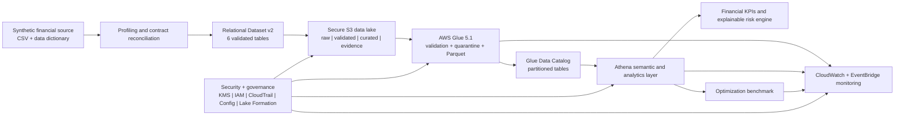

# ZIPCO Financial Risk Intelligence Platform

Serverless AWS data engineering, financial analytics, explainable risk scoring, and operational governance—built and verified in `us-east-2`.

> This repository uses deterministic synthetic financial data. It contains no real customer records and does not reconstruct real customer history.

## What this project demonstrates

- Dataset profiling and data-dictionary reconciliation on a one-million-row source extract
- Remediation of a broken flat-file relational model into six governed entities
- A private, encrypted, versioned, lifecycle-managed Amazon S3 data lake
- AWS Glue validation, quarantine, CSV-to-Parquet transformation, and catalog registration
- Athena semantic views, validation queries, and portfolio analytics
- A repeatable CSV/Parquet/partition benchmark with correctness gates
- CloudWatch dashboards, alarms, failure-event monitoring, and versioned evidence
- An explainable transaction/account/customer risk engine with decision-ready review queues
- A security and governance control plane with customer-managed encryption, audit logging, persona-based access, continuous compliance, and data classification
- An isolated Lake Formation LF-TBAC demonstration with automated authorized/denied Athena access probes

## Architecture



## Verified outcomes

| Layer | Evidence-backed result |
|---|---|
| Source profile | 1,000,000 rows × 14 columns; 0 nulls; 0 exact duplicate rows |
| Relational remediation | 6 tables; 31/31 publication rules passed |
| S3 foundation | Private, encrypted, versioned, TLS-only, lifecycle-managed |
| Glue pipeline | `DEPLOYED_RUN_AND_VERIFIED`; quality `PASS`; 0 rejected records |
| Curated layer | 6 Snappy Parquet tables; transaction and market-year partitions |
| Athena validation | 8/8 validation queries and 4/4 portfolio queries passed |
| Optimization | 88.21% CSV-to-Parquet full-scan reduction |
| Partitioned workload | 95.55% reduction from full Parquet to the pruned 2023 workload |
| Monitoring | 3 EventBridge rules, 3 alarms, and an operational dashboard |
| Risk engine | 6 views, 10/10 validations, 6/6 analytics products, 6/6 saved queries |
| Security and governance | `DEPLOYED_RUN_AND_VERIFIED`; 24/24 controls, 4/4 IAM personas, and 15/15 Config rules passed |
| IAM/Lake Formation demo | `DEPLOYED_RUN_AND_VERIFIED`; 18/18 controls, 4/4 persona mappings, 12/12 hybrid opt-ins, and observed allow/deny Athena probes |

## Repository map

| Path | Contents |
|---|---|
| [`phases/01-foundation`](phases/01-foundation/README.md) | Dataset analysis, architecture, contracts, S3 controls, and evidence |
| [`phases/02-glue-etl`](phases/02-glue-etl/README.md) | Glue ETL, data-quality rules, quarantine, lineage, and implementation |
| [`phases/03-optimization`](phases/03-optimization/README.md) | Athena/Parquet/partition benchmark and observability |
| [`phases/04-business-intelligence`](phases/04-business-intelligence/README.md) | Financial KPIs, explainable risk engine, review queues, and governance |
| [`phases/05-security-governance`](phases/05-security-governance/README.md) | KMS, IAM personas, CloudTrail, AWS Config, Access Analyzer, classification, and security evidence |
| [`phases/05-security-governance/lake-formation-demo`](phases/05-security-governance/lake-formation-demo/README.md) | Isolated hybrid Lake Formation registration, LF-TBAC persona grants, allow/deny query probes, and evidence contract |
| [`platform/s3`](platform/s3) | S3 baseline deployment and verified controls contract |
| [`platform/data-generation`](platform/data-generation) | Deterministic relational-v2 generator |
| [`platform/athena`](platform/athena/README.md) | Athena views, validation SQL, analytics SQL, and deployment automation |
| [`data`](data/README.md) | Data availability, exclusions, and regeneration guidance |
| [`scripts`](scripts) | Repository validation checks |

## Phase status

1. **Dataset analysis, architecture, and S3 — complete**
2. **Glue ETL and data quality — complete**
3. **Athena, Parquet, partitions, and optimization benchmark — complete**
4. **Financial analytics and explainable risk engine — complete**
5. **Security and governance — complete and verified, including the isolated IAM/Lake Formation access-control demonstration**

Detailed status and evidence boundaries are recorded in [PROJECT_STATUS.md](PROJECT_STATUS.md).

## Reproducing the platform

The AWS deployment bundles were designed for the verified account and Ohio region. Review resource names and costs before reuse.

1. Generate relational v2 with [`platform/data-generation/generate_zipco_relational_v2.py`](platform/data-generation/generate_zipco_relational_v2.py).
2. Deploy the secure S3 foundation from [`platform/s3`](platform/s3).
3. Deploy and run Glue from [`phases/02-glue-etl/implementation`](phases/02-glue-etl/implementation).
4. Deploy Athena views and validation from [`platform/athena`](platform/athena).
5. Deploy the benchmark and monitoring layer from [`phases/03-optimization/implementation`](phases/03-optimization/implementation).
6. Deploy the risk engine from [`phases/04-business-intelligence/implementation`](phases/04-business-intelligence/implementation).
7. Deploy and verify the security control plane from [`phases/05-security-governance/implementation`](phases/05-security-governance/implementation).
8. Deploy the isolated IAM/Lake Formation proof from [`phases/05-security-governance/lake-formation-demo/implementation`](phases/05-security-governance/lake-formation-demo/implementation).

Each deployment can incur AWS charges. The repository does not include credentials or access tokens.

## Responsible-use boundary

The deterministic risk engine prioritizes synthetic activity for analyst review. It must not be represented as a fraud determination, AML disposition, credit score, underwriting model, customer eligibility decision, or adverse-action mechanism. See [governance and responsible use](phases/04-business-intelligence/governance-and-responsible-use.md).

## Portfolio highlights

- Built an AWS-verified PySpark pipeline that validates 2.34 million relational records across six datasets and publishes governed Parquet only when quality gates pass.
- Measured an 88.21% full-scan reduction from CSV to Parquet and a 95.55% workload-level reduction from full Parquet to a partition-pruned 2023 query.
- Delivered an explainable Athena risk engine scoring one million transactions, 150,000 accounts, and 100,000 customers with component-level reason codes.
- Deployed and verified isolated Lake Formation LF-TBAC with four persona mappings, 12 scoped hybrid opt-ins, a successful authorized query, and an expected denied query.

## Validation

Run the repository checks with:

```powershell
python scripts/validate_repository.py
```

The GitHub Actions workflow runs the same validation on every push and pull request.
