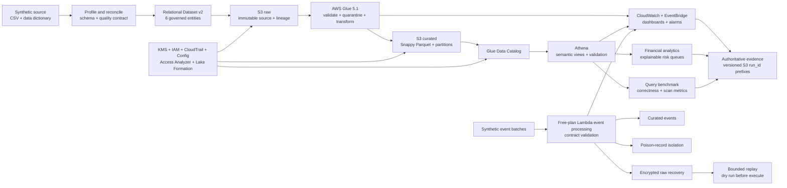

# ZIPCO Platform Architecture

## Design intent

ZIPCO is a serverless AWS data platform that turns deterministic synthetic financial activity into governed analytical products and explainable risk-prioritization outputs. The design separates immutable inputs, quality-controlled publication, analytical consumption, operational recovery, and security evidence.

## End-to-end system

## Service responsibilities

| Layer | Primary components | Responsibility |
|---|---|---|
| Source and contract | Python, CSV, YAML/JSON contracts | Deterministic generation, profiling, schema reconciliation, and publish rules |
| Storage | Amazon S3 | Private raw, validated, curated, quarantine, results, recovery, and evidence prefixes |
| Processing | AWS Glue 5.1 | Referential validation, quality gates, quarantine, enrichment, and CSV-to-Parquet publication |
| Metadata | Glue Data Catalog | Governed table definitions and partition discovery |
| Analytics | Amazon Athena | Reconciliation tests, semantic views, financial KPIs, risk queues, and saved queries |
| Performance | Athena and CloudWatch | Correctness-gated CSV/Parquet/partition comparison and operational metrics |
| Event resilience | AWS Lambda, S3, CloudWatch | Free-plan contract validation, raw-first backup, poison-record isolation, replay, and alarms |
| Security | KMS, IAM, CloudTrail, AWS Config, Access Analyzer, Lake Formation | Encryption, least-privilege personas, auditability, continuous checks, and isolated LF-TBAC proof |

## Data zones and publication rules

| Zone | Mutation policy | Consumer rule |
|---|---|---|
| Raw | Source-aligned and retained for lineage | Never treated as analytics-ready |
| Validated | Structurally accepted inputs | Eligible for transformation only after contract checks |
| Quarantine/errors | Invalid or relationally unsafe records | Investigate and remediate; never silently publish |
| Curated | Quality-gated Snappy Parquet | Primary analytical source |
| Analytics/risk | Views and query products | Reproducible, versioned logic with responsible-use limits |
| Evidence | Run-specific JSON and supporting records | Versioned, encrypted, and referenced by `run_id` |

Transactions are partitioned for time-pruned workloads. Partitioning is a workload optimization, not a substitute for row-level validation or catalog governance.

## Trust boundaries

- Git contains infrastructure, contracts, code, source-labelled transcripts, screenshots, and small deterministic evidence—not credentials or large financial datasets.
- S3 contains authoritative AWS run evidence and governed data products. Local JSON transcriptions preserve provenance and never masquerade as directly downloaded AWS records.
- IAM personas separate data engineering, risk analysis, stewardship, and security audit duties. Root CloudShell use is a bootstrap exception, not the routine operating model.
- The isolated Lake Formation hybrid-mode demonstration proves scoped allow/deny behavior without changing enforcement on the three existing analytics databases.
- The risk score is an explainable synthetic prioritization heuristic. It is not a fraud, AML, credit, underwriting, eligibility, or adverse-action decision.

## Resilience and delivery semantics

The verified account plan did not permit native Kinesis or Firehose deployment. The selected implementation therefore uses Free-plan Lambda event processing with S3 recovery. Native streaming is not claimed.

The verified path is raw-first and at least once. Replay begins in dry-run mode, operates on a bounded recovery set, records a batch fingerprint, and requires downstream de-duplication on `transaction_id`.

## Deployment topology

- Verified region: Ohio (`us-east-2`)
- Primary data lake: `zipco-financial-platform-825999268272-us-east-2`
- Analytics workgroup: `zipco-risk-analytics`
- Core catalog database: `zipco_financial_risk`
- Analytics database: `zipco_financial_analytics`
- Risk database: `zipco_financial_risk_engine`

For implementation details, start with the [project handoff](PROJECT_HANDOFF.md) and follow the linked phase runbooks.
