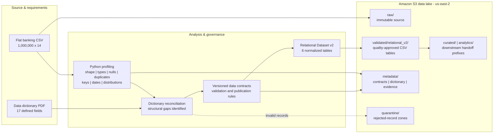
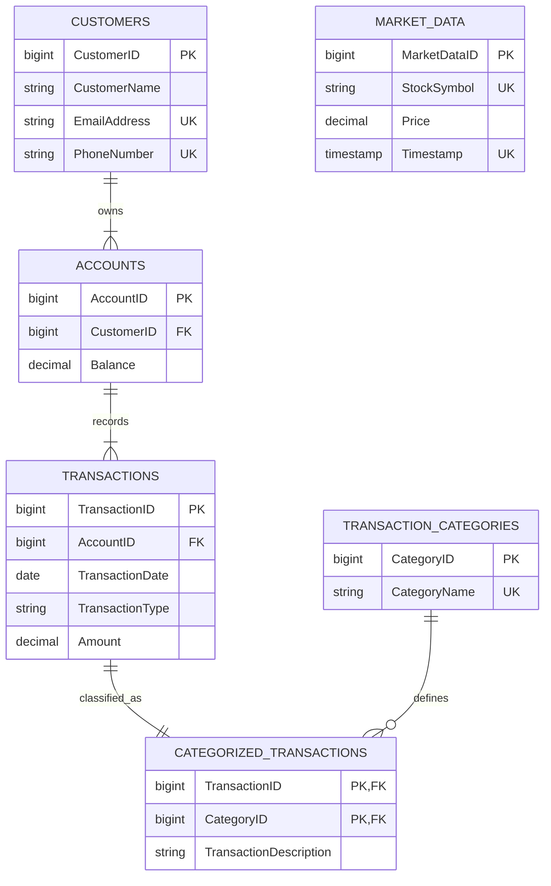

# ZIPCO Financial Risk Intelligence Platform

## Dataset Analysis, Architecture, Data Contract & Secure S3 Foundation

This case study documents the foundation of a production-style financial data platform on AWS. I profiled a one-million-row synthetic banking extract, reconciled it with its supplied data dictionary, exposed structural defects hidden by superficially clean data, designed a governed six-table relational contract, and deployed a secure, lifecycle-managed Amazon S3 data lake in `us-east-2`.

> Portfolio scope: synthetic data engineering and governance demonstration. The dataset does not represent real customers or reconstructed customer histories.

## Executive results

| Result | Evidence |
|---|---:|
| Source profiled | 1,000,000 rows x 14 columns |
| Null values | 0 |
| Exact duplicate rows | 0 |
| Structural defect discovered | Identifier and functional-dependency failures in the flat extract |
| Dictionary fields absent from source | `CategoryName`, `StockSymbol`, `Timestamp` |
| Relational remediation | 6 governed tables |
| Data-quality publication gate | 31/31 rules passed |
| Referential-integrity failures in v2 | 0 |
| S3 security | Private, encrypted, versioned, TLS-only |
| S3 governance | 5 lifecycle rules and purpose-specific prefixes |
| AWS deployment region | Ohio (`us-east-2`) |

## The engineering problem

The supplied CSV appeared clean because it contained no null values and no exact duplicate rows. Deeper profiling showed that it could not satisfy the relational model in the data dictionary:

- `CustomerID`, `AccountID`, `TransactionID`, `CategoryID`, and `MarketDataID` each contained only 10 distinct values across one million rows.
- The supposed identifiers did not functionally determine their dependent attributes.
- A repeated `TransactionID` could describe different accounts, dates, transaction types, and amounts.
- Emails were not stable customer identifiers and phone values required string handling.
- The dictionary required `CategoryName`, `StockSymbol`, and `Timestamp`, but the CSV omitted them.
- The flat extract mixed customer, account, transaction, category, and market entities in one record shape.

The key lesson was that **completeness and row-level uniqueness do not prove relational integrity**.

## Architecture

S3 applies Block Public Access, bucket-owner-enforced ownership, SSE-S3 default encryption, versioning, a TLS-only bucket policy, project tags, and lifecycle controls. See [Architecture and data lineage](architecture-and-lineage.md) for the full diagrams.

## Relational data contract

`MARKET_DATA` remains standalone because the supplied dictionary defines no valid relationship between market observations and banking transactions. Inventing a join would create misleading analytics.

## S3 zone design

| Prefix | Purpose | Governance behavior |
|---|---|---|
| `raw/` | Immutable source landing | Archive to Standard-IA after 30 days and Glacier Instant Retrieval after 90 days |
| `validated/relational_v2/` | Quality-approved relational tables | Source for downstream transformation |
| `curated/` | Analytics-ready handoff | Reserved during this phase; populated by the Glue phase |
| `analytics/` | Derived analytical products | Separated from source and curated storage |
| `quarantine/` | Schema, duplicate, and business-rule failures | Expire after 365 days |
| `metadata/contracts/` | Contracts, profiling results, and verification evidence | Versioned governance record |
| `metadata/data_dictionary/` | Supplied reference documentation | Preserves source requirements |
| `athena-results/` | Query-result staging baseline | Expire after 30 days |

Additional controls abort incomplete multipart uploads after seven days and expire selected noncurrent processed versions after 90 days.

## Data-quality publication gate

The v2 dataset was published only after 31 rules passed across:

- Expected table populations
- Primary and composite-key uniqueness
- Foreign-key integrity
- Functional dependencies
- Transaction-type and category compatibility
- Monetary domains and precision
- Date and timestamp validity
- Required-field completeness
- Unique canonical email and phone values
- One category per transaction
- Market symbol/timestamp uniqueness

Published populations:

| Table | Rows |
|---|---:|
| Customers | 100,000 |
| Accounts | 150,000 |
| Transactions | 1,000,000 |
| Transaction categories | 10 |
| Categorized transactions | 1,000,000 |
| Market data | 87,140 |

## Design decisions that mattered

1. **Preserve raw evidence.** The original flat extract remains unchanged for lineage and auditability.
2. **Repair the model without pretending to recover history.** Relational v2 is deterministic synthetic remediation, not a reconstruction of real customer relationships.
3. **Separate validation from transformation.** Only quality-approved records enter the validated zone.
4. **Honor documented relationships.** Market data is not joined to transactions because the dictionary supplies no valid key.
5. **Make governance testable.** Remote object size, SHA-256 metadata, encryption, versioning, prefix presence, and bucket controls were verified after deployment.

## Portfolio evidence

- [Architecture and data-lineage diagrams](architecture-and-lineage.md)
- [Evidence catalog with screenshot captions](evidence/evidence-catalog.md)
- [Source profiling and dictionary reconciliation](evidence/zipco_phase2_profile_and_data_contract.md)
- [Original flat-extract contract](contracts/zipco_data_contract_v1.yaml)
- [Validated relational-v2 contract](contracts/zipco_data_contract_v2.yaml)
- [Relational-v2 data-quality results](evidence/data_quality_results.json)
- [S3 controls manifest](evidence/zipco_s3_controls.json)
- [Portfolio-proof checklist](portfolio-proof-checklist.md)

## Technologies demonstrated

Python, pandas-based profiling, relational modeling, data contracts, data-quality testing, Amazon S3, AWS CloudShell, AWS CLI/SDK automation, encryption, lifecycle management, object versioning, integrity hashing, and data-lake zone design.

## Resume-ready summary

- Profiled a one-million-row synthetic financial dataset and identified relational defects that null and duplicate checks alone did not expose.
- Designed and validated a six-table relational data contract with 31 automated quality rules and zero orphan foreign keys.
- Deployed a private, encrypted, versioned Amazon S3 data lake with TLS enforcement, lifecycle policies, governed prefixes, and post-deployment integrity verification.
