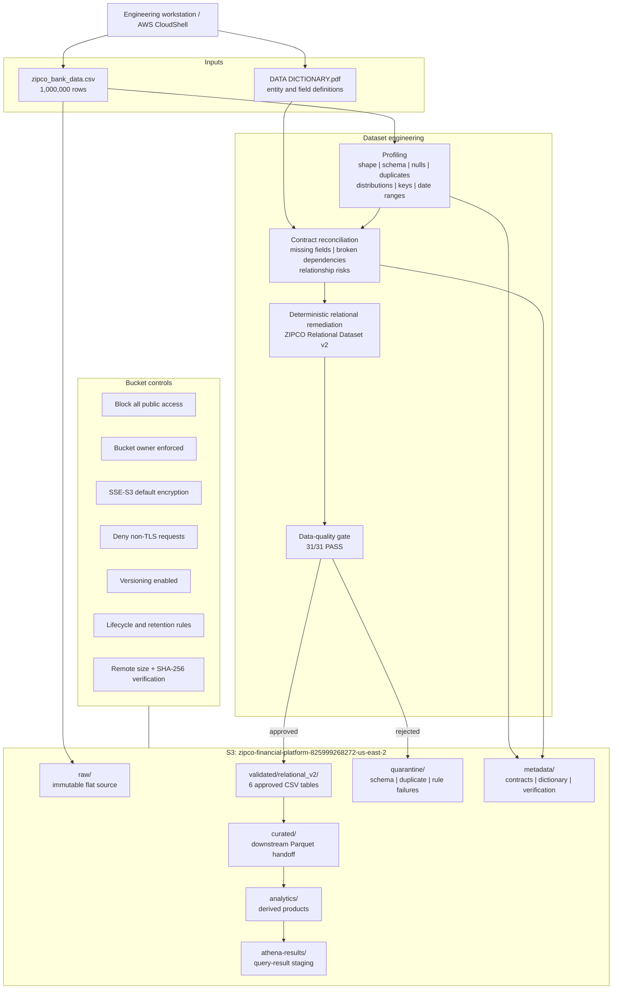
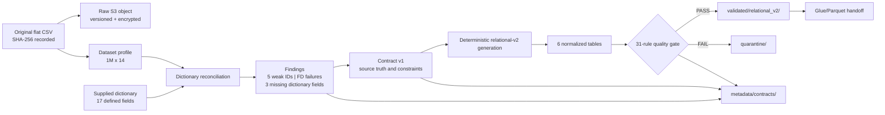
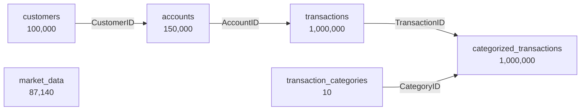

# Architecture and Data Lineage

## AWS foundation architecture

## Data lineage and publication gates

## Relational lineage

Market data is intentionally isolated. No transaction-to-market edge is shown because none exists in the supplied data dictionary.

## Security and retention map

| Control | Applied behavior | Risk addressed |
|---|---|---|
| Block Public Access | All four settings enabled | Accidental public exposure |
| Ownership | `BucketOwnerEnforced` | ACL ambiguity and cross-owner objects |
| Encryption | `AES256` by default | Unencrypted objects at rest |
| Transport | Explicit deny when `aws:SecureTransport=false` | Plaintext network access |
| Versioning | Enabled | Accidental overwrite and lineage loss |
| Raw lifecycle | Standard-IA at 30 days; Glacier IR at 90 days | Long-term storage cost |
| Quarantine lifecycle | Expire at 365 days | Unbounded rejected-data retention |
| Athena-result lifecycle | Expire at 30 days | Unbounded query-result storage |
| Multipart cleanup | Abort after 7 days | Orphaned upload costs |
| Integrity verification | Remote size and SHA-256 metadata | Truncated or incorrect uploads |
