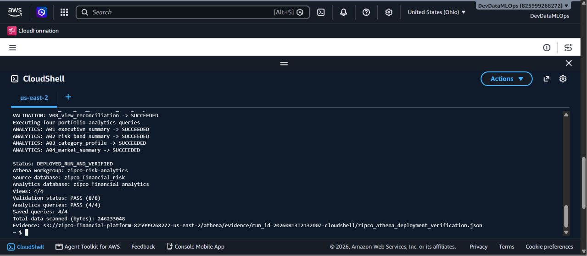
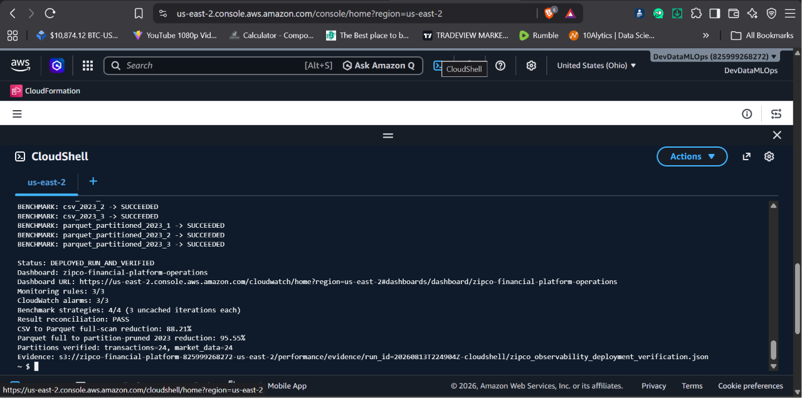
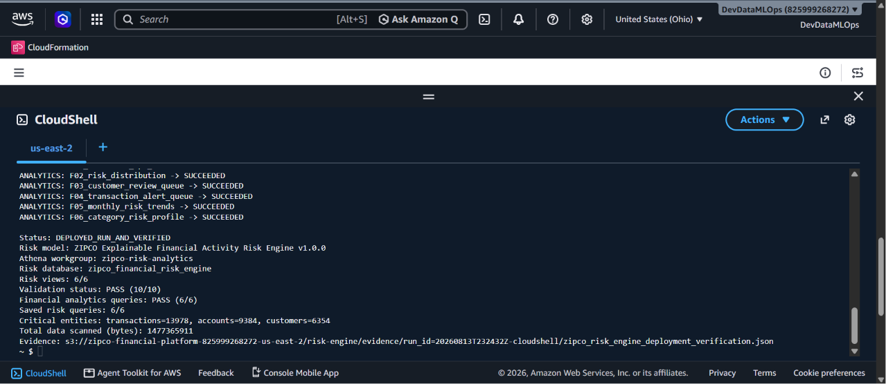

# Portfolio Evidence Catalog

## Primary Phase 1 evidence

| Artifact | What it proves |
|---|---|
| [`zipco_phase2_profile_and_data_contract.md`](zipco_phase2_profile_and_data_contract.md) | The one-million-row profile, suspicious values, key-integrity failures, date range, distributions, and reconciliation with the supplied dictionary |
| [`zipco_data_contract_v1.yaml`](../contracts/zipco_data_contract_v1.yaml) | The governed description of the original flat source and its documented limitations |
| [`zipco_data_contract_v2.yaml`](../contracts/zipco_data_contract_v2.yaml) | The approved six-table relational schema, key constraints, domains, and relationship decisions |
| [`data_quality_results.json`](data_quality_results.json) | The machine-readable 31-rule publication gate with overall status `PASS` |
| [`zipco_s3_controls.json`](zipco_s3_controls.json) | The bucket, prefix, security, lifecycle, and post-upload verification contract |
| [`architecture-and-lineage.md`](../architecture-and-lineage.md) | The AWS architecture, data lineage, relational lineage, and security-control map |

## AWS deployment record

The Phase 1 CloudShell deployment was observed with:

```text
Status: DEPLOYED_AND_VERIFIED
Bucket: s3://zipco-financial-platform-825999268272-us-east-2
Region: us-east-2
```

The deployment verified bucket controls plus remote object size, SHA-256 metadata, encryption, and object version identifiers. The local portfolio copy expresses those controls in [`zipco_s3_controls.json`](zipco_s3_controls.json); the operational verification record remains in the AWS deployment environment.

## Curated screenshots

The screenshots below are downstream verification evidence. They demonstrate that the Phase 1 contracts and S3 foundation successfully supported the later Glue/Athena, partitioning, monitoring, benchmarking, and risk-engine layers.

### 1. Athena analytical layer verified



**Caption:** Athena deployment completed with four views, eight validation rules, four analytics queries, and four saved queries. This confirms that the relational contract and S3-backed catalog supported governed analytical consumption.

### 2. Partitioning, monitoring, and performance verified



**Caption:** Operational monitoring deployed with three EventBridge rules and three CloudWatch alarms. The benchmark measured an 88.21% CSV-to-Parquet scan reduction and a further 95.55% reduction from partition pruning, confirming that the foundational zone design supported optimized downstream storage.

### 3. Explainable risk engine verified



**Caption:** The explainable risk engine deployed six views, passed ten validation rules, executed six analytics products, and registered six saved queries. This provides end-to-end proof that the original architecture and data contract could support a production-style analytical workload.

## Public-portfolio note

The screenshots display the AWS account identifier and project resource names. AWS account IDs are not credentials, but they can be masked before publishing if preferred. No access keys, session tokens, passwords, or customer secrets are included.

