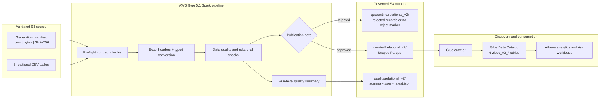

# ZIPCO Financial Risk Intelligence Platform

## AWS Glue ETL, Data Quality & Curated Data Pipeline

This case study demonstrates a working, controlled AWS Glue pipeline for ZIPCO Relational Dataset v2. The pipeline validates six relational CSV tables, enforces schema and business rules, quarantines rejected records, blocks unsafe publication, converts approved data to Snappy-compressed Parquet, registers the outputs in the AWS Glue Data Catalog, and leaves machine-readable run evidence in Amazon S3.

> Portfolio scope: synthetic financial data engineering. The records do not represent real customers or reconstructed customer histories.

## Executive results

| Result | Verified outcome |
|---|---:|
| Glue deployment | `DEPLOYED_RUN_AND_VERIFIED` |
| Glue job | `zipco-relational-v2-validation-transform` |
| Runtime quality status | `PASS` |
| Records rejected | 0 |
| Source records evaluated across six tables | 2,337,150 |
| Curated tables published | 6 |
| Crawler status | `SUCCEEDED` |
| Data Catalog database | `zipco_financial_risk` |
| Curated format | Apache Parquet with Snappy compression |
| Partitioned datasets | `transactions` and `market_data` |
| Year partitions verified downstream | 24 per partitioned dataset |
| Later measured CSV-to-Parquet scan reduction | 88.21% |

## The engineering problem

The validated relational-v2 CSV files satisfied the data contract, but they were not yet an analytics-ready lakehouse layer. A portfolio-quality pipeline also needed to prove that it could:

- Reject schema drift before processing.
- Convert text fields into durable analytical types.
- Enforce keys, foreign keys, required fields, domains, ranges, and relationship rules.
- Preserve rejected records with enough context for investigation.
- Prevent curated publication when quality thresholds fail.
- Produce compressed and partitioned Parquet.
- Register a stable, exact table set for Athena and later analytical workloads.
- Generate repeatable deployment and run evidence.

## Pipeline architecture

See [Pipeline architecture and lineage](pipeline-architecture-and-lineage.md) for the complete processing and control-flow diagrams.

## What the ETL job implements

### Source controls

Before Glue starts, the deployment workflow verifies each source object against its manifest: declared rows, object bytes, SHA-256 metadata, dataset version `2.0.0`, and SSE-S3 encryption. Inside Glue, each CSV header must exactly match its contracted column order.

### Transformations

- Casts identifiers to `BIGINT`-compatible values.
- Casts financial values to `DECIMAL(18,2)`.
- Parses transaction dates and market timestamps.
- Trims names, phone numbers, descriptions, categories, and transaction types.
- Lowercases email addresses and uppercases stock symbols.
- Adds `TransactionYear` and `MarketYear` partition columns.
- Writes Parquet with Snappy compression and controlled output-file sizing.

### Data-quality enforcement

The Spark job applies 37 row-level rule applications across the six tables, six locked population checks, two cross-table completeness checks, and a configurable overall reject-rate threshold. It covers:

- Required identifiers and values
- Primary, alternate, and composite-key uniqueness
- Customer-account, account-transaction, and transaction-category foreign keys
- Email, Nigerian phone, stock-symbol, monetary, date, and timestamp validity
- Transaction-type domain enforcement
- Transaction/category compatibility
- Exactly one category per transaction
- Every valid account participating in at least one transaction

The detailed mapping is in the [Transformation and data-quality rule catalog](transformation-and-dq-rule-catalog.md).

## Fail-safe publication behavior

Curated publication is blocked when any of the following is true:

1. Overall reject rate exceeds 1%.
2. A valid transaction has no category.
3. A valid account has no transaction.
4. A table population differs from the locked relational-v2 manifest.

Rejected rows retain the dataset, original JSON record, one or more error codes, source filename, pipeline run ID, and processing timestamp. A zero-reject run writes an explicit `NO_REJECTS.json` marker rather than leaving an ambiguous empty folder.

## AWS implementation

CloudFormation provisions:

- An AWS Glue 5.1 Spark job with autoscaling enabled and two G.1X workers configured.
- A least-privilege Glue service role scoped to required ZIPCO data-lake prefixes.
- An encrypted Glue security configuration.
- The `zipco_financial_risk` Data Catalog database.
- The `zipco-relational-v2-curated-crawler` crawler over six curated locations.

The deployment runner validates the source contract, deploys or updates the stack, executes the job, verifies `PASS` and zero rejects, starts and verifies the crawler, confirms the exact six-table catalog set, checks that every curated dataset contains Parquet objects, and uploads a final verification record to S3.

## Curated outputs

| Dataset | Curated location | Partitioning |
|---|---|---|
| Customers | `curated/relational_v2/customers/` | None |
| Accounts | `curated/relational_v2/accounts/` | None |
| Transactions | `curated/relational_v2/transactions/` | `TransactionYear` |
| Transaction categories | `curated/relational_v2/transaction_categories/` | None |
| Categorized transactions | `curated/relational_v2/categorized_transactions/` | None |
| Market data | `curated/relational_v2/market_data/` | `MarketYear` |

All locations are under `s3://zipco-financial-platform-825999268272-us-east-2/` in Ohio (`us-east-2`).

## Portfolio evidence

- [Pipeline architecture and source-to-curated lineage](pipeline-architecture-and-lineage.md)
- [Transformation and data-quality rule catalog](transformation-and-dq-rule-catalog.md)
- [Before-and-after schema and storage comparison](before-after-comparison.md)
- [Curated Parquet data contract](contracts/zipco_curated_contract_v2.yaml)
- [AWS Glue run verification](evidence/glue_aws_deployment_verification.json)
- [31-rule relational-v2 quality result](evidence/data_quality_results.json)
- [Evidence catalog and screenshot captions](evidence/evidence-catalog.md)
- [Phase completion checklist](portfolio-proof-checklist.md)
- [Deployable implementation](implementation/)

## Technologies demonstrated

AWS Glue 5.1, Apache Spark, PySpark, Amazon S3, AWS Glue Data Catalog, Glue crawlers, CloudFormation, IAM least privilege, CloudWatch logging and observability metrics, Parquet, Snappy compression, partitioning, data contracts, automated data-quality gates, quarantine design, AWS CLI, and deployment verification.

## Resume-ready summary

- Built and AWS-verified a PySpark ETL pipeline that validated 2.34 million relational records across six datasets, produced zero rejects, and blocked publication on schema, population, or relationship failures.
- Converted governed CSV inputs into Snappy-compressed Parquet and partitioned transaction and market datasets by year for Athena-efficient consumption.
- Automated Glue infrastructure, execution, quarantine, quality reporting, crawler registration, exact catalog verification, and S3 evidence capture with CloudFormation and AWS CLI.

