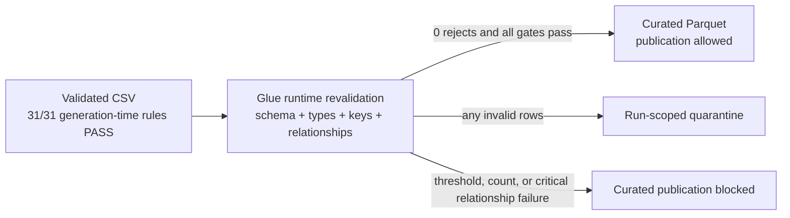

# Before and After: Validated Source to Curated Analytics Layer

## Storage and processing comparison

| Dimension | Before Glue: validated relational v2 | After Glue: curated analytical layer |
|---|---|---|
| Physical format | CSV | Apache Parquet |
| Compression | Not format-managed | Snappy |
| Schema handling | Contract documented; CSV values read as text | Exact header check plus explicit Spark types |
| Financial precision | Text representation in CSV | `DECIMAL(18,2)` |
| Dates and timestamps | Text representation | Spark `DATE` and `TIMESTAMP` |
| Key enforcement | Pre-publication v2 validation results | Rechecked during the operational ETL run |
| Relationship enforcement | Contract and local 31-rule gate | Spark foreign-key, compatibility, and completeness checks |
| Bad-record handling | Source generation must pass before upload | Structured per-run quarantine with error codes and lineage |
| Publication safety | Validated-source approval | Curated output blocked on threshold, count, or critical relationship failure |
| Partitioning | None in the CSV objects | Transactions by `TransactionYear`; market data by `MarketYear` |
| Discovery | Files and contract | Six tables registered in Glue Data Catalog |
| Run evidence | Generation manifest and data-quality JSON | Per-run quality summary, latest pointer, CloudWatch logs, crawler result, and deployment-verification JSON |
| Query efficiency | Row-oriented full-file scans | Column pruning, compression, and year partition pruning |

## Schema evolution

| Field family | Source representation | Curated representation |
|---|---|---|
| Entity IDs | CSV strings at ingestion | 64-bit integer-compatible values |
| `Balance`, `Amount`, `Price` | CSV strings | `DECIMAL(18,2)` |
| `TransactionDate` | `yyyy-MM-dd` text | `DATE` |
| `Timestamp` | ISO timestamp text | `TIMESTAMP` |
| Customer email | Source text | Trimmed, lowercased, validated text |
| Stock symbol | Source text | Trimmed, uppercased, validated text |
| Transaction partition | Absent | Derived `TransactionYear` |
| Market partition | Absent | Derived `MarketYear` |

## Quality posture

## Measured downstream impact

The later Athena performance phase used these Glue outputs and verified:

- 24 transaction-year partitions.
- 24 market-year partitions.
- 88.21% fewer bytes scanned for a Parquet full scan than the equivalent CSV full scan.
- A further 95.55% scan reduction when the Parquet query pruned to the 2023 partition.

Those benchmark results are downstream evidence that the Glue transformation changed the dataset from merely valid files into an efficient analytical storage layer.

