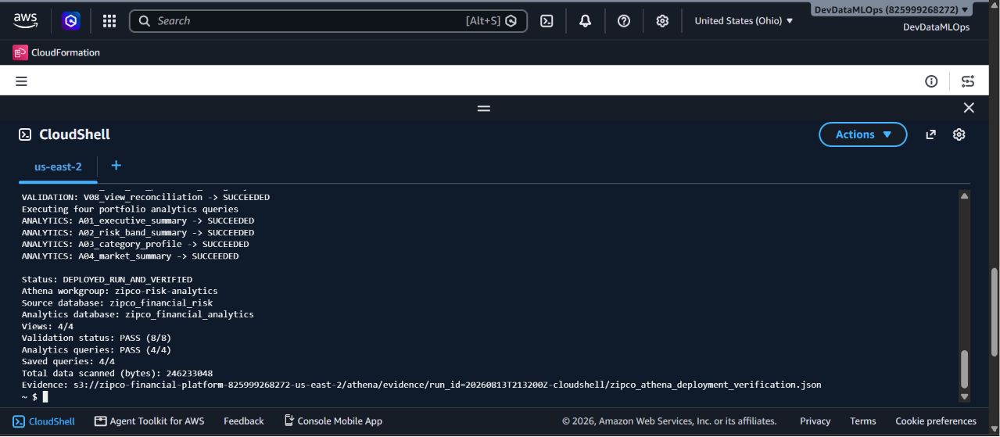
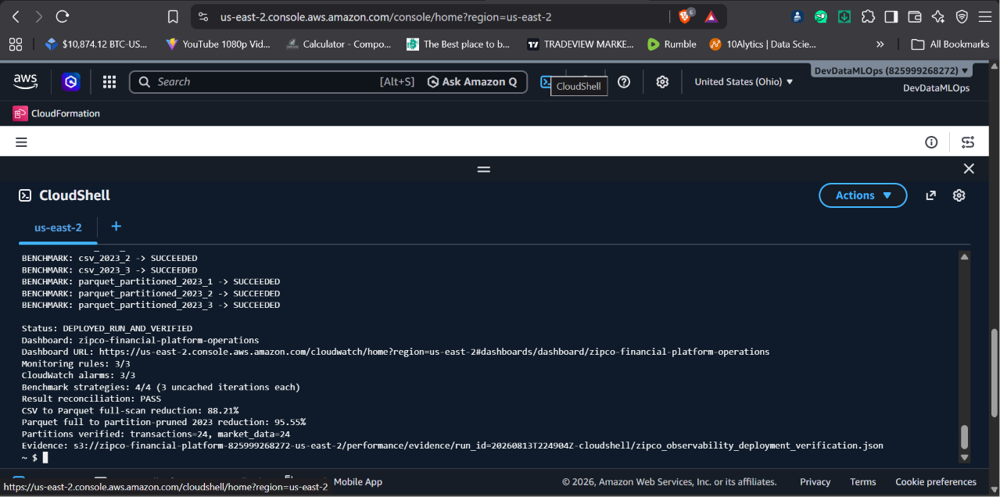
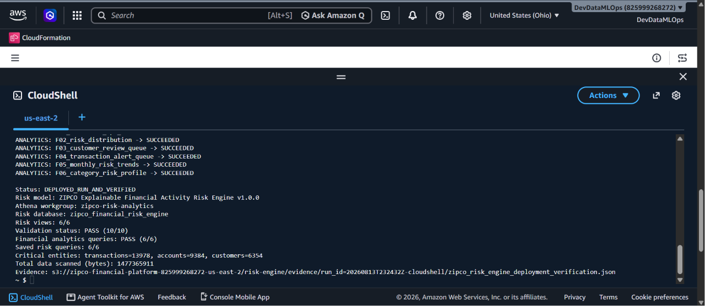

# Portfolio Evidence Catalog

## Primary Glue-phase evidence

| Artifact | What it proves |
|---|---|
| [`glue_aws_deployment_verification.json`](glue_aws_deployment_verification.json) | The AWS job, quality, rejection, crawler, catalog, curated-location, and downstream verification outcomes transcribed from the user-supplied CloudShell output |
| [`data_quality_results.json`](data_quality_results.json) | The machine-readable 31-rule relational-v2 input gate with overall status `PASS` |
| [`zipco_curated_contract_v2.yaml`](../contracts/zipco_curated_contract_v2.yaml) | The deployed curated locations, Parquet types, partitioning, keys, quality threshold, quarantine shape, and expected populations |
| [`zipco_relational_v2_etl.py`](../implementation/zipco_relational_v2_etl.py) | Executable PySpark transformations, rule applications, quarantine construction, publication gate, quality metrics, and Parquet writes |
| [`zipco_glue_infrastructure.json`](../implementation/zipco_glue_infrastructure.json) | CloudFormation for IAM, Glue security, job, database, and crawler resources |
| [`deploy_and_run_zipco_glue.sh`](../implementation/deploy_and_run_zipco_glue.sh) | Repeatable source verification, stack deployment, job execution, crawler execution, catalog checks, Parquet checks, and evidence upload |
| [`bundle_manifest.json`](../implementation/bundle_manifest.json) | Pre-deployment build manifest and SHA-256 checks for the original deployment bundle; its `PENDING_CLOUDSHELL_RUN` field records the bundle's state before the later verified AWS run |
| [`pipeline-architecture-and-lineage.md`](../pipeline-architecture-and-lineage.md) | Architecture, decision flow, table lineage, relational enforcement, and operational evidence flow |
| [`transformation-and-dq-rule-catalog.md`](../transformation-and-dq-rule-catalog.md) | Human-readable mapping of every transformation and row-level error code |
| [`before-after-comparison.md`](../before-after-comparison.md) | The change from validated CSV files to typed, partitioned, cataloged Parquet |

## AWS run evidence and provenance

The user supplied AWS CloudShell output showing:

```text
Status: DEPLOYED_RUN_AND_VERIFIED
Glue job: zipco-relational-v2-validation-transform
Quality status: PASS
Rejected records: 0
Crawler status: SUCCEEDED
Catalog database: zipco_financial_risk
Catalog tables: 6 expected zipco_v2_* tables
Curated prefix: s3://zipco-financial-platform-825999268272-us-east-2/curated/relational_v2/
```

The deployment workflow created a machine-generated verification JSON and uploaded it to:

`s3://zipco-financial-platform-825999268272-us-east-2/metadata/contracts/relational_v2/zipco_glue_deployment_verification.json`

That remote object is the authoritative AWS-side execution record. The local [`glue_aws_deployment_verification.json`](glue_aws_deployment_verification.json) explicitly identifies itself as a transcription so the portfolio does not misrepresent it as an S3 export.

The implementation bundle manifest is intentionally preserved unchanged. Its pre-run `PENDING_CLOUDSHELL_RUN` value and the later `DEPLOYED_RUN_AND_VERIFIED` evidence represent two different points in the deployment lifecycle, not conflicting status claims.

## Downstream screenshots

These screenshots independently demonstrate that the Glue-created catalog and Parquet layer supported later platform phases.

### 1. Athena analytics and query validation



**Caption:** Four analytical views, eight validation queries, four portfolio analytics queries, and four saved queries succeeded against the Glue-cataloged data. This confirms that the curated outputs were queryable and relationally coherent.

### 2. Parquet partition and performance verification



**Caption:** The downstream benchmark verified 24 transaction partitions and 24 market-data partitions, an 88.21% full-scan reduction from CSV to Parquet, and a further 95.55% reduction from year-partition pruning.

### 3. Explainable risk workload consumption



**Caption:** Six risk views, ten validations, and six financial analytics queries passed on top of the curated and cataloged relational layer, demonstrating a real downstream consumer rather than an isolated ETL demo.

## Publication note

The screenshots display the AWS account identifier and resource names. The account ID is not a credential, but it may be masked before public publication. No access keys, session tokens, passwords, or customer secrets are included.
