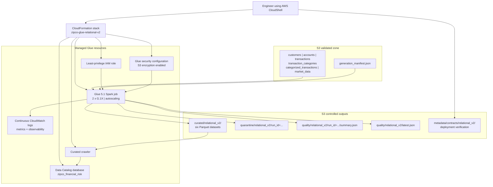
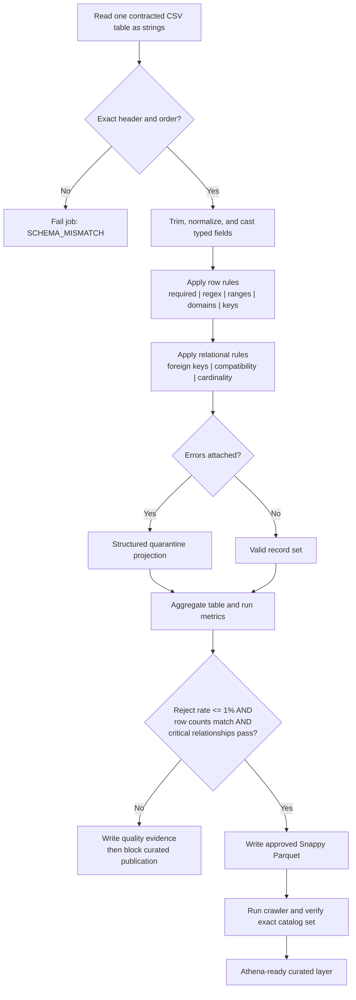
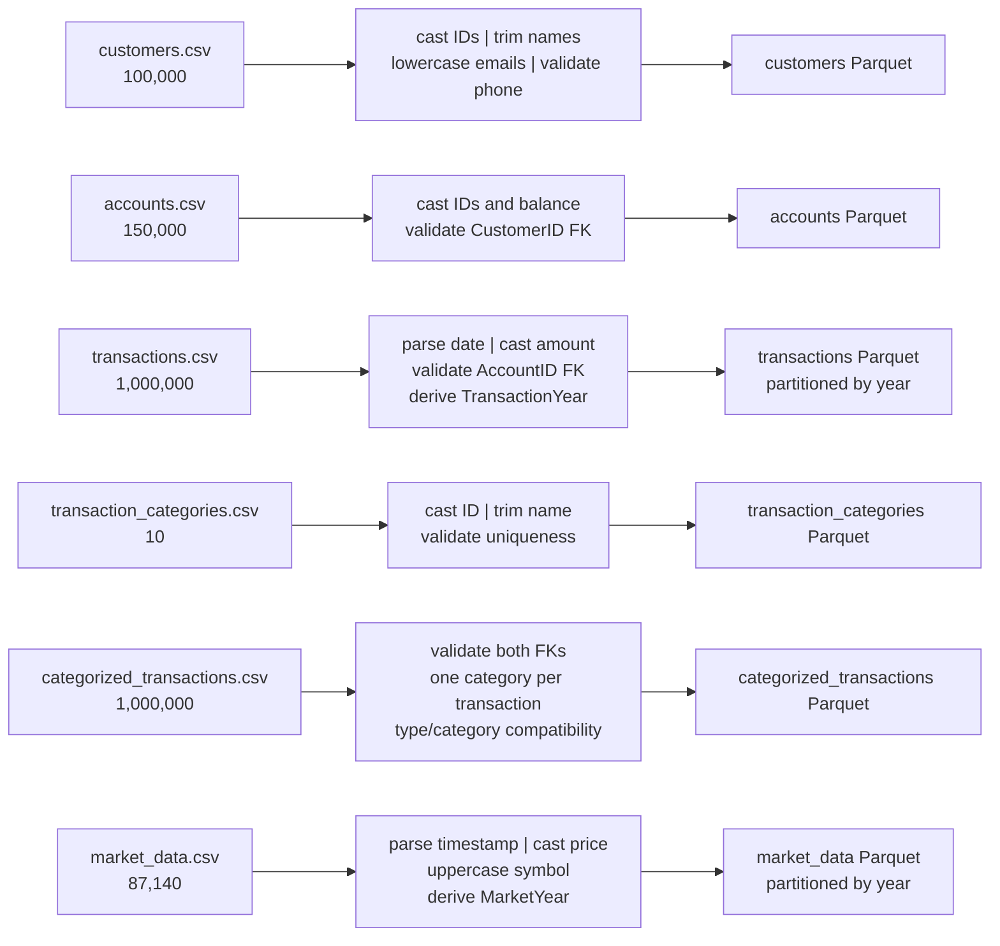
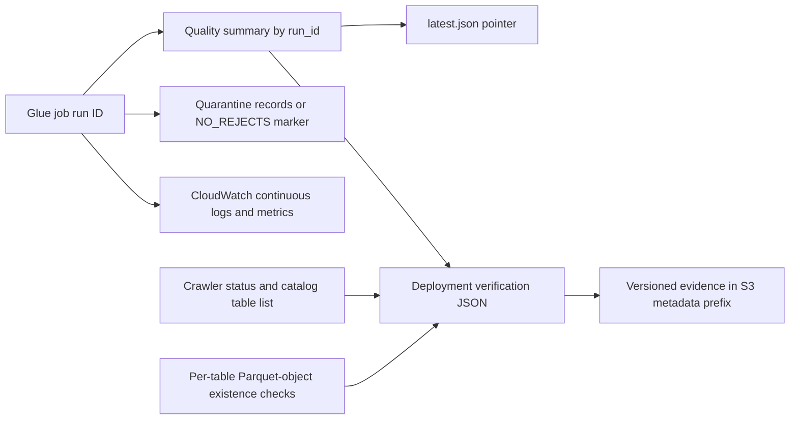

# Pipeline Architecture and Data Lineage

## AWS Glue working pipeline



## Validation and publication decision flow



## Source-to-curated lineage



## Relational enforcement map

```mermaid
erDiagram
    CUSTOMERS ||--|{ ACCOUNTS : "CustomerID validated"
    ACCOUNTS ||--|{ TRANSACTIONS : "AccountID validated"
    TRANSACTIONS ||--|| CATEGORIZED_TRANSACTIONS : "TransactionID validated"
    TRANSACTION_CATEGORIES ||--o{ CATEGORIZED_TRANSACTIONS : "CategoryID validated"

    CUSTOMERS {
        bigint CustomerID PK
        string EmailAddress UK
        string PhoneNumber UK
    }
    ACCOUNTS {
        bigint AccountID PK
        bigint CustomerID FK
        decimal Balance
    }
    TRANSACTIONS {
        bigint TransactionID PK
        bigint AccountID FK
        date TransactionDate
        int TransactionYear PARTITION
    }
    TRANSACTION_CATEGORIES {
        bigint CategoryID PK
        string CategoryName UK
    }
    CATEGORIZED_TRANSACTIONS {
        bigint TransactionID PK,FK
        bigint CategoryID PK,FK
    }
    MARKET_DATA {
        bigint MarketDataID PK
        string StockSymbol UK
        timestamp Timestamp UK
        int MarketYear PARTITION
    }
```

`MARKET_DATA` remains intentionally standalone because the supplied data dictionary defines no valid key relating market observations to banking transactions.

## Operational evidence flow



