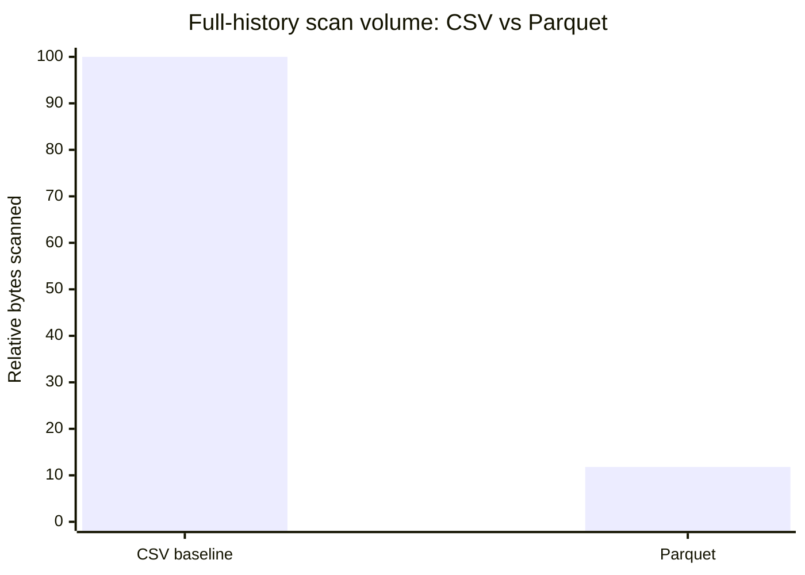
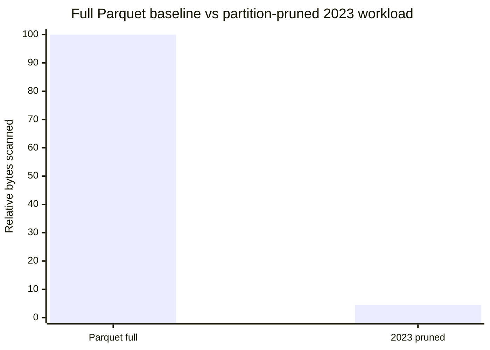
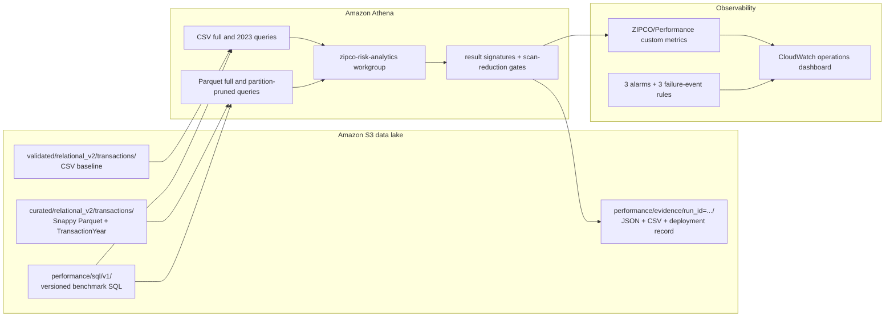

# ZIPCO Financial Risk Intelligence Platform

## Athena, Parquet, Partitioning & Optimization Benchmark

This case study demonstrates how I measured—not merely assumed—the analytical benefit of converting ZIPCO transaction data from CSV to Parquet and pruning queries with year partitions. The benchmark executed four Athena strategies three times each with result reuse disabled, reconciled query outputs with SHA-256 signatures, captured scan and execution metrics, published custom CloudWatch metrics, and stored a versioned evidence record in Amazon S3.

> Portfolio scope: synthetic financial data engineering. Benchmark percentages are measured AWS results from the supplied CloudShell run.

## Executive results

| Result | Verified outcome |
|---|---:|
| AWS status | `DEPLOYED_RUN_AND_VERIFIED` |
| Benchmark strategies | 4/4 |
| Uncached iterations | 3 per strategy; 12 measured executions |
| Full-scan result reconciliation | PASS |
| 2023 result reconciliation | PASS |
| CSV to Parquet full-scan reduction | **88.21%** |
| Parquet full to partition-pruned 2023 reduction | **95.55%** |
| Transaction partitions | 24 |
| Market-data partitions | 24 |
| Monitoring rules | 3/3 |
| CloudWatch alarms | 3/3 |
| Operations dashboard | `zipco-financial-platform-operations` |

## Optimization result

Parquet retained only **11.79%** of the CSV full-scan volume, a measured reduction of **88.21%** for semantically equivalent aggregation queries.

The 2023 partition-pruned workload retained **4.45%** of the full-history Parquet scan volume. This is a workload-level comparison: it combines a narrower 2023 date scope with partition pruning and should not be described as a pure partition-only causal estimate.

See [Benchmark results and interpretation](benchmark-results-and-interpretation.md) for the test design, correctness gates, cost implications, and limitations.

## The engineering question

The purpose of the phase was not to show that Athena could query Parquet. It was to answer:

> Can the platform prove that its optimized layout returns the same business result while scanning materially less data, and can it preserve enough evidence to reproduce and defend that claim?

The benchmark therefore measured both performance and correctness.

## Architecture

The full system and experimental-design diagrams are in [Architecture and benchmark methodology](architecture-and-methodology.md).

## Benchmark strategies

| Strategy | Format | Scope | Optimization being exercised |
|---|---|---|---|
| `csv_full` | CSV | Full history | Baseline row-oriented scan and runtime casting |
| `parquet_full` | Parquet | Full history | Columnar storage, typed values, and compression |
| `csv_2023` | CSV | 2023 | Correctness baseline for the year-filtered workload |
| `parquet_partitioned_2023` | Parquet | 2023 | Explicit `TransactionYear` partition predicate plus date filter |

Each query groups by `TransactionType` and returns transaction count and transaction value. Every strategy must return exactly three result rows.

## Why the evidence is credible

- Athena result reuse was explicitly disabled for all 12 measured runs.
- Each SQL file was hashed and each execution ID was captured.
- Metrics recorded bytes scanned, engine time, and total execution time.
- All three iterations for a strategy had to produce one stable result signature.
- CSV and Parquet full-history signatures had to match.
- CSV and partitioned-Parquet 2023 signatures had to match.
- Parquet had to scan fewer bytes than CSV.
- The partition-pruned 2023 workload had to scan fewer bytes than full Parquet.
- The Glue Catalog partition key and both partition populations were verified before the benchmark.
- The deployment failed automatically if a validity gate was not met.

## Operational monitoring

The phase also deployed:

- A CloudWatch dashboard for benchmark scan volume, engine execution time, scan-reduction percentages, Athena workgroup metrics, Glue Spark outcomes, alarms, and captured failures.
- EventBridge rules for failed Glue jobs, Glue crawlers, and Athena queries.
- A 30-day failure-event log group.
- Alarms for governed pipeline failures, Athena scans of at least 1 GiB within five minutes, and failed Glue Spark tasks.

See [Monitoring and cost controls](monitoring-and-cost-controls.md).

## Portfolio evidence

- [Business outcome, evidence chain, and reproducible cost model](business-outcome-and-cost-model.md)

- [Benchmark results and interpretation](benchmark-results-and-interpretation.md)
- [Architecture and benchmark methodology](architecture-and-methodology.md)
- [Monitoring and cost controls](monitoring-and-cost-controls.md)
- [Verified benchmark contract](contracts/zipco_verified_optimization_benchmark.json)
- [AWS execution evidence](evidence/aws_optimization_benchmark_verification.json)
- [Portable benchmark summary CSV](evidence/benchmark_summary.csv)
- [Evidence catalog and screenshot captions](evidence/evidence-catalog.md)
- [Deployable SQL, CloudFormation, and automation](implementation/)
- [Completion checklist](portfolio-proof-checklist.md)

## Technologies demonstrated

Amazon Athena, Apache Parquet, Snappy compression, Glue Data Catalog partitions, S3, CloudWatch dashboards and custom metrics, CloudWatch alarms, EventBridge, CloudWatch Logs, CloudFormation, AWS CLI, SQL result reconciliation, SHA-256 evidence, performance benchmarking, and cost-aware data engineering.

## Resume-ready summary

- Designed and executed a 12-run Athena benchmark with result reuse disabled and signature-based correctness gates across CSV, Parquet, and partition-pruned strategies.
- Measured an 88.21% reduction in full-scan bytes after converting CSV to Parquet and a 95.55% workload-level reduction from full Parquet to a partition-pruned 2023 query.
- Operationalized the benchmark with custom CloudWatch metrics, a dashboard, three alarms, three validated failure-event rules, and versioned S3 evidence.
