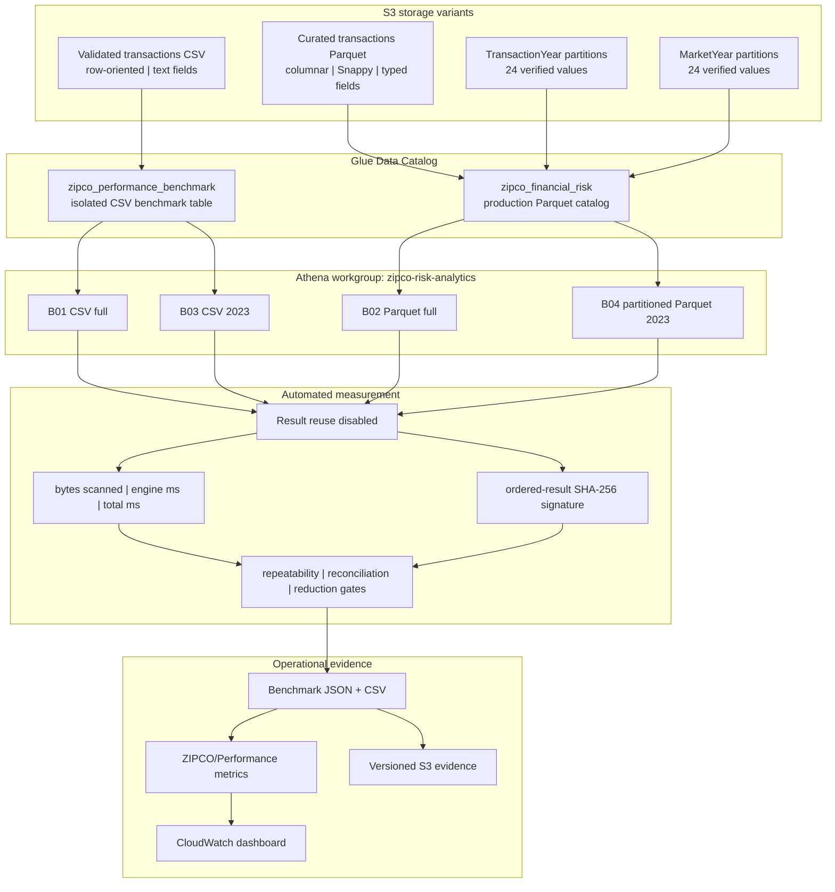
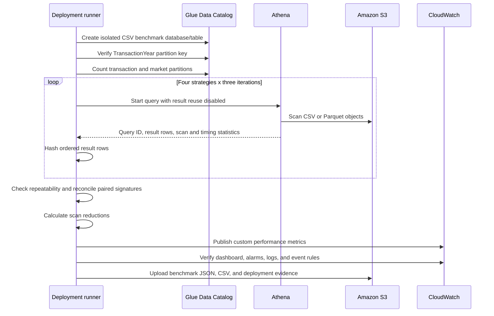
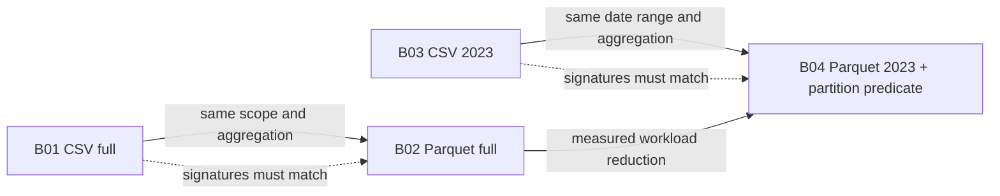
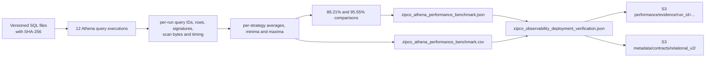

# Architecture and Benchmark Methodology

## Optimization architecture

## Execution sequence

## Comparison design

The solid horizontal pairs are correctness comparisons. The full-history pair also provides a direct storage-format comparison. The arrow from full Parquet to partitioned 2023 is the reported workload-level pruning comparison.

## Evidence lineage

## Controlled scope

The benchmark-only CSV table is isolated in `zipco_performance_benchmark`; it does not change the six-table production Glue contract. All Athena executions use the governed `zipco-risk-analytics` workgroup, and the benchmark SQL is stored under a versioned S3 prefix.

