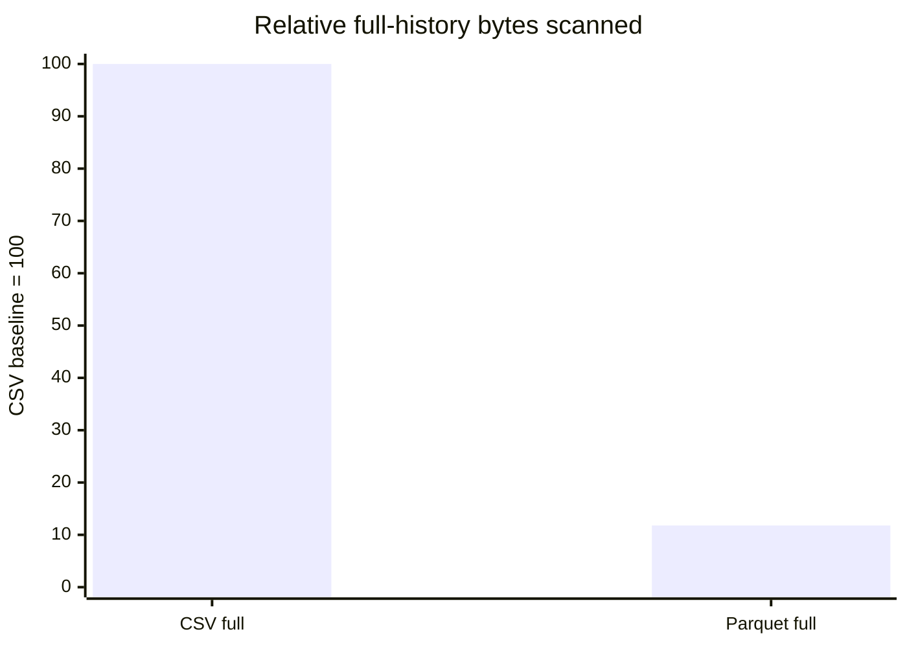
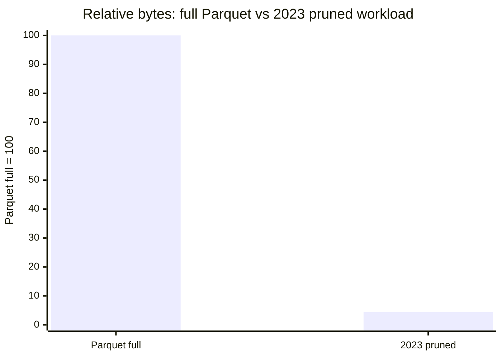
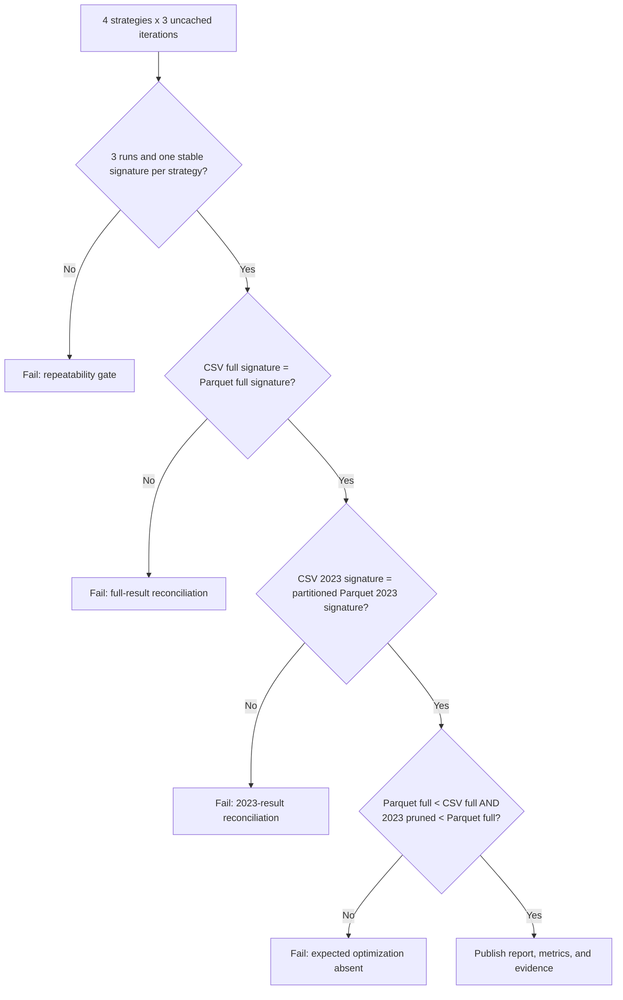

# Benchmark Results and Interpretation

## Measured scan reductions

| Comparison | Baseline normalized scan | Optimized normalized scan | Reduction | Correctness control |
|---|---:|---:|---:|---|
| CSV full history vs Parquet full history | 100.00 | 11.79 | **88.21%** | Exact result-signature reconciliation |
| Parquet full history vs partition-pruned 2023 workload | 100.00 | 4.45 | **95.55%** | 2023 result reconciled independently against CSV 2023 |

The normalized scan values are derived directly from the measured percentages. Exact per-strategy byte and latency statistics remain in the AWS-generated benchmark JSON under the run-specific S3 evidence prefix; they were not reproduced from memory in this local package.

## Full-scan format comparison

This is the strongest direct optimization claim in the experiment. `B01_csv_full.sql` and `B02_parquet_full.sql` use the same aggregation and full-history scope. Their output signatures reconciled, so the **88.21%** scan reduction is attributable to the storage and typing difference represented by the benchmark: CSV with runtime casting versus typed, Snappy-compressed Parquet.

## Partition-pruned workload comparison

The **95.55%** result compares the full-history Parquet query with a 2023 query that includes both an explicit `TransactionYear` partition predicate and a date filter. It proves the scan benefit of the production workload shape, but it does not isolate partitioning from the narrower time scope.

The test still protects correctness: `B03_csv_2023.sql` and `B04_parquet_partitioned_2023.sql` use the same 2023 date range and their output signatures had to match exactly.

## Experimental matrix

| ID | Query | Dataset | Filter behavior | Expected rows |
|---|---|---|---|---:|
| B01 | Full transaction-type aggregate | CSV | None | 3 |
| B02 | Full transaction-type aggregate | Parquet | None | 3 |
| B03 | 2023 transaction-type aggregate | CSV | Runtime date cast and date range | 3 |
| B04 | 2023 transaction-type aggregate | Partitioned Parquet | Explicit partition predicate and date range | 3 |

Every result contains one row for each of Deposit, Transfer, and Withdrawal with `transaction_count` and `transaction_value`.

## Measurement method

For each of the four strategies, the runner:

1. Injected a unique run ID, strategy, and iteration comment into the SQL.
2. Disabled Athena result reuse.
3. Waited for successful completion and captured the query execution ID.
4. Collected bytes scanned, engine execution time, and total execution time.
5. Required exactly three result rows.
6. Hashed the ordered result rows into a SHA-256 result signature.
7. Repeated the query three times.
8. Calculated average, minimum, and maximum scan volume plus average execution metrics.

## Validity gates

## Cost interpretation

For Athena workloads billed primarily by bytes scanned, the scan reductions provide a defensible relative cost indicator:

- The full-history Parquet query used 11.79% of the CSV scan volume, implying approximately the same proportional reduction in scan-based query charges for that query shape, before minimum billing, regional pricing, result storage, or other service charges.
- The partition-pruned 2023 workload used 4.45% of the full-history Parquet scan volume. Because the workload scope also changed, this is a useful operational cost comparison rather than a pure partition-only savings estimate.

No fixed dollar estimate is included because pricing and billing minimums can change, and the exact byte measurements are preserved in the AWS evidence report.

## What this benchmark proves

- The Parquet conversion materially reduced scan volume without changing full-history business results.
- The year-partitioned layout supports a substantially smaller 2023 analytical workload.
- Partition metadata existed and was queryable in the Glue Catalog.
- The optimization results were repeatable across three uncached executions per strategy.
- Performance metrics and correctness evidence were produced by the same automated run.

## What it does not prove

- It is not a broad concurrency, stress, or multi-user benchmark.
- It does not isolate every cause of execution-time variation.
- The 95.55% result is not a pure partition-only causal estimate.
- It does not establish a permanent dollar cost because Athena pricing can change.
- It does not compare alternative Parquet file sizes, compression codecs, bucketing, or table formats.

These boundaries make the portfolio claim more credible: the evidence supports a precise optimization result without overstating the experiment.

