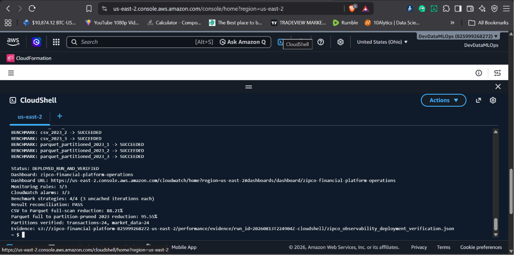
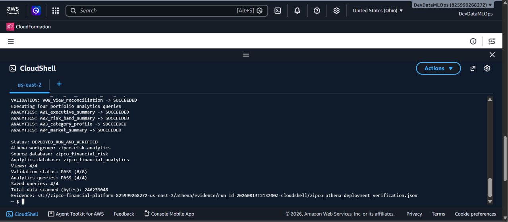
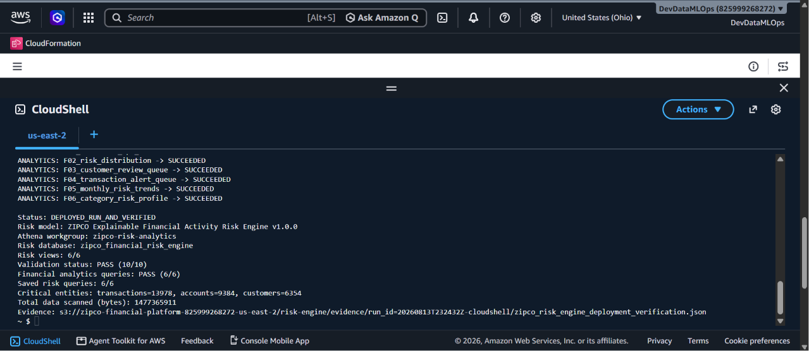

# Portfolio Evidence Catalog

## Primary optimization evidence

| Artifact | What it proves |
|---|---|
| [`aws_optimization_benchmark_verification.json`](aws_optimization_benchmark_verification.json) | The successful AWS deployment, benchmark percentages, partition counts, monitoring resources, run ID, and authoritative S3 locations transcribed from the supplied CloudShell output |
| [`benchmark_summary.csv`](benchmark_summary.csv) | A portable summary of the two measured reductions and their normalized scan volumes, with interpretation boundaries |
| [`zipco_verified_optimization_benchmark.json`](../contracts/zipco_verified_optimization_benchmark.json) | The verified test design, validity gates, outcomes, interpretation boundaries, and evidence contract |
| [`benchmark-results-and-interpretation.md`](../benchmark-results-and-interpretation.md) | The comparison charts, test matrix, measurement method, cost interpretation, and experiment limitations |
| [`architecture-and-methodology.md`](../architecture-and-methodology.md) | The storage/query architecture, benchmark sequence, correctness comparisons, and evidence lineage |
| [`monitoring-and-cost-controls.md`](../monitoring-and-cost-controls.md) | Dashboard coverage, EventBridge rules, alarms, failure logs, and scan-cost control chain |
| [`deploy_and_run_zipco_observability.sh`](../implementation/deploy_and_run_zipco_observability.sh) | Automated benchmark execution, result hashing, reconciliation, reduction gates, custom metrics, monitoring verification, and S3 evidence upload |
| [`zipco_observability_infrastructure.json`](../implementation/zipco_observability_infrastructure.json) | CloudFormation for the benchmark database, dashboard, log group, metric filter, EventBridge rules, and alarms |
| [`benchmark/`](../implementation/benchmark/) | The exact DDL and four SQL strategies used by the AWS benchmark |

## AWS execution record

The user supplied a successful AWS CloudShell output containing:

```text
Status: DEPLOYED_RUN_AND_VERIFIED
Dashboard: zipco-financial-platform-operations
Monitoring rules: 3/3
CloudWatch alarms: 3/3
Benchmark strategies: 4/4 (3 uncached iterations each)
Result reconciliation: PASS
CSV to Parquet full-scan reduction: 88.21%
Parquet full to partition-pruned 2023 reduction: 95.55%
Partitions verified: transactions=24, market_data=24
```

The authoritative machine-generated files remain under:

`s3://zipco-financial-platform-825999268272-us-east-2/performance/evidence/run_id=20260813T224904Z-cloudshell/`

The local evidence JSON is explicitly labeled as a transcription. This avoids presenting reconstructed summary values as though the AWS-generated per-query report had been downloaded locally.

## Screenshots

### 1. Optimization and monitoring deployment verified



**Caption:** The final AWS output confirms the dashboard, three monitoring rules, three alarms, four benchmark strategies with three uncached iterations each, result reconciliation, both scan reductions, both partition counts, and the run-specific S3 evidence location.

### 2. Athena analytical layer verified



**Caption:** The governed Athena workgroup and analytical databases were successfully deployed and validated before the performance workload was executed.

### 3. Downstream risk workload verified



**Caption:** The optimized Parquet and partitioned analytical layer supported a later six-view explainable risk engine, demonstrating that the performance design served a real downstream workload.

## Publication note

The screenshots display an AWS account identifier and resource names. The account ID is not a credential, but it may be masked before public publication. No access keys, session tokens, passwords, or customer secrets are shown.
