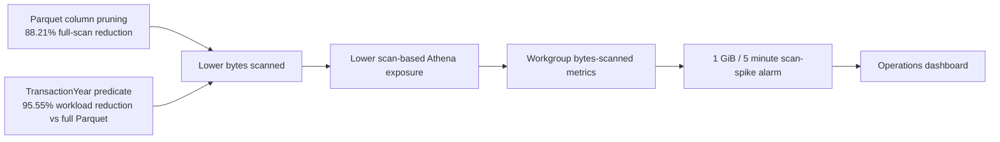

# Monitoring and Cost Controls

## CloudWatch dashboard

The deployed dashboard `zipco-financial-platform-operations` contains:

| Dashboard view | Purpose |
|---|---|
| Active operational alarms | Immediate pipeline and query risk visibility |
| Average data scanned by strategy | Compare CSV, Parquet, and partition-pruned workloads |
| Average engine execution time | Compare execution behavior alongside scan volume |
| Measured scan reduction | Show the two verified reduction percentages |
| Athena successful DML bytes scanned | Track governed workgroup scan volume over time |
| Athena successful DML latency | Track query engine latency |
| Glue Spark task outcomes | Compare completed and failed ETL tasks |
| Captured pipeline failure events | Monitor the custom failure-event metric |
| Recent governed pipeline failures | Inspect logged failure details |

## Event monitoring

| Rule | Captured state | Verified behavior |
|---|---|---|
| `zipco-glue-job-failures` | Failed, timed-out, or stopped Glue jobs | Enabled, one target, test event matched |
| `zipco-glue-crawler-failures` | Failed curated crawler runs | Enabled, one target, test event matched |
| `zipco-athena-query-failures` | Failed queries in `zipco-risk-analytics` | Enabled, one target, test event matched |

Matched events are sent to `/aws/events/zipco-financial-platform/failures` with a 30-day retention period.

## Alarms

| Alarm | Trigger represented by the infrastructure |
|---|---|
| `zipco-pipeline-failure-events` | At least one governed failure event |
| `zipco-athena-successful-dml-scan-spike` | Successful Athena DML scans at least 1 GiB within five minutes |
| `zipco-glue-failed-spark-tasks` | At least one failed Glue Spark task |

All three alarms were verified in AWS. They do not send email or SMS because no notification destination was supplied; SNS notification is a separate enhancement.

## Cost-control chain

## Cost interpretation boundaries

The benchmark presents scan reductions instead of a hard-coded currency estimate. That avoids making the portfolio dependent on a regional price that may change. Relative savings can be estimated from measured bytes for workloads billed by data scanned, while accounting separately for minimum query charges, CloudWatch resources, S3 result storage, Glue costs, and any future visualization service.

QuickSight was intentionally not deployed in this phase because it may require separate account activation and additional charges. The CloudWatch dashboard is the operational dashboard; business-intelligence visualization remains a distinct product layer.

