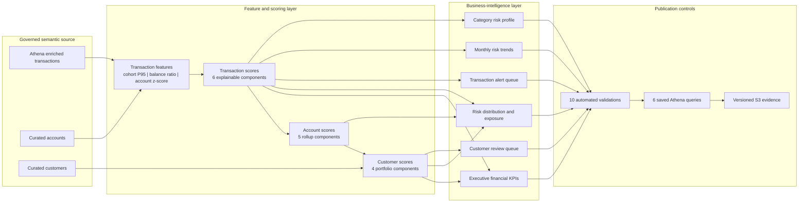

# ZIPCO Financial Risk Intelligence Platform

## Financial Analytics, Explainable Risk Engine & Business Intelligence

This case study turns the governed ZIPCO relational platform into decision-ready financial intelligence. It combines reconciled portfolio KPIs, explainable transaction/account/customer risk scores, executive summaries, review queues, monthly trends, and category profiles in a reusable Athena semantic layer.

> Portfolio scope: synthetic financial data and analyst-prioritization demonstration. The risk engine is not a fraud finding, AML disposition, credit score, underwriting model, customer eligibility decision, or adverse-action mechanism.

## Executive results

| Result | Verified outcome |
|---|---:|
| AWS deployment | `DEPLOYED_RUN_AND_VERIFIED` |
| Risk model | ZIPCO Explainable Financial Activity Risk Engine v1.0.0 |
| Reusable risk and KPI views | 6/6 |
| Publication-gate validations | PASS, 10/10 |
| Financial analytics products | PASS, 6/6 |
| Saved Athena queries | 6/6 |
| Scored populations | 1,000,000 transactions; 150,000 accounts; 100,000 customers |
| Critical transactions | 13,978 |
| Critical accounts | 9,384 |
| Critical customers | 6,354 |
| Athena bytes scanned during deployment | 147,736,591 |

## Executive portfolio snapshot

The financial values below are computed from ZIPCO Relational Dataset v2. Deployed validation `RE-008` passed, confirming that the Athena KPI view reconciled its customer, account, balance, transaction, and transaction-type totals to that source layer.

| KPI | Value |
|---|---:|
| Customers | 100,000 |
| Accounts | 150,000 |
| Transactions | 1,000,000 |
| Total account balance | 758,585,675.53 units |
| Total transaction value | 5,004,344,506.67 units |
| Average transaction amount | 5,004.34 units |
| Deposit value | 1,669,546,315.82 units |
| Withdrawal value | 1,664,683,573.22 units |
| Transfer value | 1,670,114,617.63 units |
| High-value transactions (`Amount >= 9,000`) | 100,188 |
| External transfers | 140,492 |
| Date coverage | 2000-01-01 through 2023-11-09 |

The supplied dictionary does not specify a currency, so the presentation reports monetary values as **units** rather than inventing a denomination.

## BI architecture

See [BI architecture and decision flow](bi-architecture-and-decision-flow.md) for the complete lineage and analyst workflow.

## Risk-band calibration

The model uses four bands at every entity level:

| Band | Score |
|---|---:|
| LOW | 0–29 |
| MEDIUM | 30–49 |
| HIGH | 50–69 |
| CRITICAL | 70–100 |

Pre-deployment calibration produced:

| Entity | LOW | MEDIUM | HIGH | CRITICAL |
|---|---:|---:|---:|---:|
| Transactions | 713,799 | 189,526 | 82,701 | 13,974 |
| Accounts | 57,481 | 36,441 | 46,732 | 9,346 |
| Customers | 39,426 | 12,548 | 41,813 | 6,213 |

The deployed AWS critical counts were 13,978 transactions, 9,384 accounts, and 6,354 customers. Small differences from calibration are expected because Athena uses `approx_percentile` for cohort thresholds, while local calibration used exact percentiles.

## Business questions answered

| Business question | BI product |
|---|---|
| What is the size and financial activity of the portfolio? | Executive KPI overview |
| How are entities distributed across risk bands and exposure? | Risk distribution |
| Which customers should analysts review first, and why? | Customer review queue |
| Which transactions require immediate review context? | Transaction alert queue |
| Is elevated activity changing over time? | Monthly risk trends |
| Which transaction categories concentrate elevated activity? | Category risk profile |

The complete definitions are in [KPI and analytics catalog](kpi-and-analytics-catalog.md).

## Explainability

Every non-zero score includes component columns and pipe-delimited reason codes. The score is deterministic and capped at 100. Transaction scores roll into account scores, which roll into customer scores; each level retains its own component reconciliation.

Examples of transparent transaction signals:

- Amount meets or exceeds the account balance for an outgoing transaction.
- Amount is at least 9,000 units.
- Amount is at or above the transaction-type/category cohort 95th percentile.
- Transaction is an external transfer.
- Amount is at least two population standard deviations above the account mean.
- Transaction type is Transfer.

Names, emails, and phone numbers are excluded from scoring. Market data remains separate because the data dictionary defines no valid transaction relationship. See [Risk-model and explainability catalog](risk-model-and-explainability.md).

## Portfolio evidence

- [BI architecture and decision flow](bi-architecture-and-decision-flow.md)
- [KPI and analytics catalog](kpi-and-analytics-catalog.md)
- [Risk-model and explainability catalog](risk-model-and-explainability.md)
- [Governance, limitations, and responsible use](governance-and-responsible-use.md)
- [Executive dashboard snapshot](dashboard/executive-dashboard.md)
- [Machine-readable KPI snapshot](evidence/bi_kpi_snapshot.json)
- [Verified risk-engine contract](contracts/zipco_verified_risk_engine.json)
- [AWS execution evidence](evidence/aws_risk_engine_verification.json)
- [Evidence catalog and screenshot captions](evidence/evidence-catalog.md)
- [Deployable Athena views, analytics, validations, and automation](implementation/)
- [Completion checklist](portfolio-proof-checklist.md)

## Technologies demonstrated

Amazon Athena, SQL semantic views, reusable BI query products, explainable deterministic scoring, transaction/account/customer rollups, financial reconciliation, risk-band calibration, analyst queues, monthly trend analytics, S3 evidence, AWS CLI automation, model contracts, validation gates, and responsible model governance.

## Resume-ready summary

- Built and AWS-verified an explainable Athena risk engine scoring one million transactions, 150,000 accounts, and 100,000 customers across three governed entity layers.
- Delivered six decision-ready BI products covering executive KPIs, risk exposure, customer and transaction review queues, monthly trends, and category-level risk profiles.
- Enforced ten publication-gate validations for population, keys, score domains, component reconciliation, reason codes, financial totals, rollups, model version, and complete risk-band coverage.
