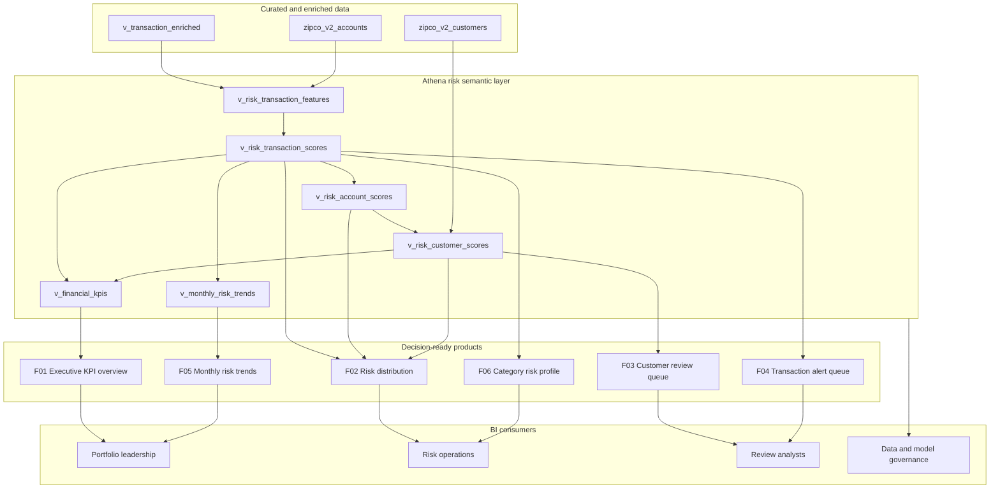
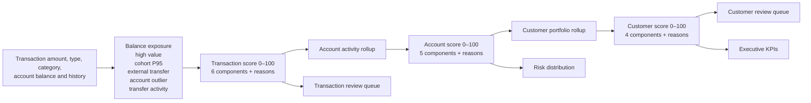
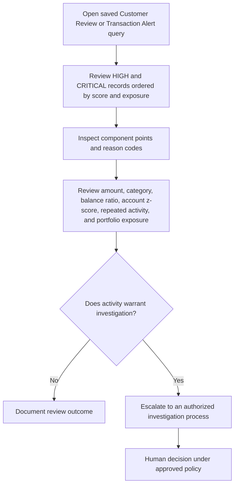
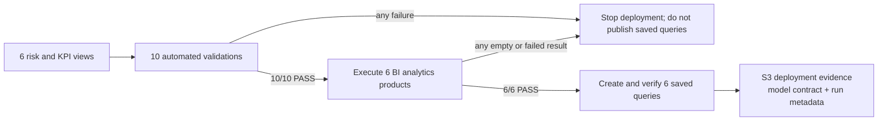

# BI Architecture and Decision Flow

## Semantic and business-intelligence architecture

## Score lineage

## Analyst decision workflow

The engine prioritizes review. It does not make the final determination shown in the last step.

## Publication and governance flow

## Business-intelligence surfaces

| Surface | Grain | Primary decision |
|---|---|---|
| Financial KPIs | Whole portfolio | Understand scale, flows, and overall risk posture |
| Risk distribution | Entity level and band | Understand concentration of entities and exposure |
| Customer review queue | Customer | Prioritize customer portfolios for analyst review |
| Transaction alert queue | Transaction | Prioritize individual activity with context |
| Monthly trends | Month | Monitor activity and elevated-risk rates over time |
| Category risk profile | Type and category | Identify categories concentrating elevated activity |
