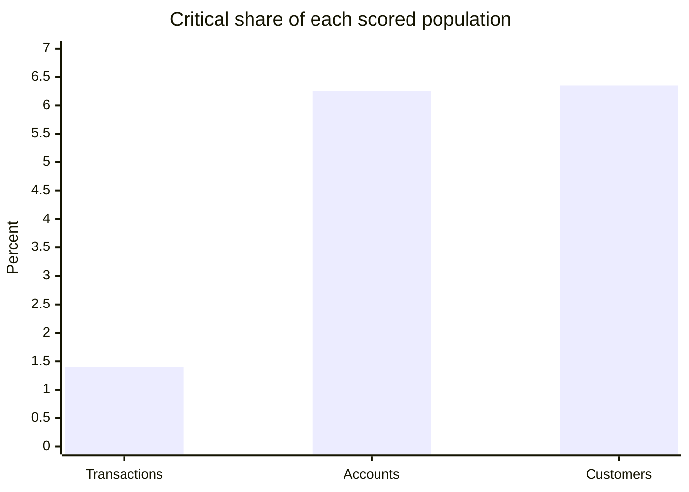
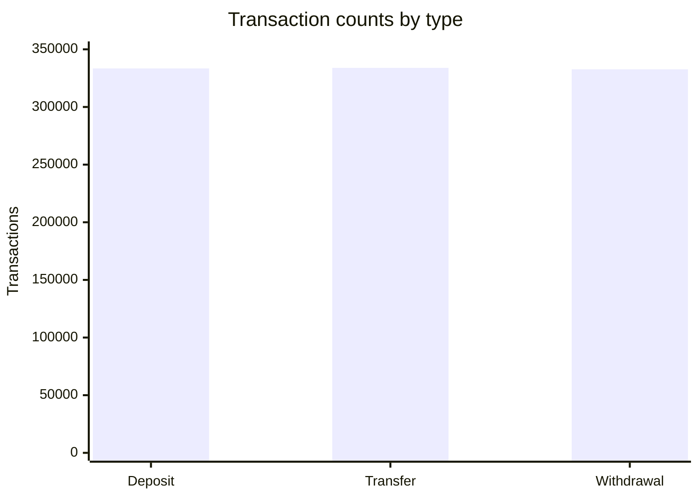

# Executive BI Dashboard Snapshot

## Portfolio scale and activity

| Customers | Accounts | Transactions | Transaction value | Total balance |
|---:|---:|---:|---:|---:|
| 100,000 | 150,000 | 1,000,000 | 5.004B units | 758.586M units |

## Deployed critical review queues

| Transactions | Accounts | Customers |
|---:|---:|---:|
| 13,978 | 9,384 | 6,354 |

## Transaction activity mix

| Type | Count | Value |
|---|---:|---:|
| Deposit | 333,442 | 1.670B units |
| Transfer | 333,881 | 1.670B units |
| Withdrawal | 332,677 | 1.665B units |

## Pre-deployment calibration distribution

| Entity | LOW | MEDIUM | HIGH | CRITICAL |
|---|---:|---:|---:|---:|
| Transactions | 71.38% | 18.95% | 8.27% | 1.40% |
| Accounts | 38.32% | 24.29% | 31.15% | 6.23% |
| Customers | 39.43% | 12.55% | 41.81% | 6.21% |

This distribution is the exact local calibration snapshot. The deployed Athena engine uses approximate cohort percentiles, so the verified AWS critical counts differ slightly.

## Operational interpretation

- The synthetic activity mix is nearly even across Deposit, Transfer, and Withdrawal; it is useful for balanced demonstrations but not an industry benchmark.
- The deployed critical queue covers about 1.40% of transactions and about 6.3% of both accounts and customers.
- A smaller critical transaction share can roll into a larger critical account/customer share because the model aggregates maximum risk, repeated activity, and exposure across entity hierarchies.
- The model surfaces review priorities and explanations; it does not determine suspicious behavior.

