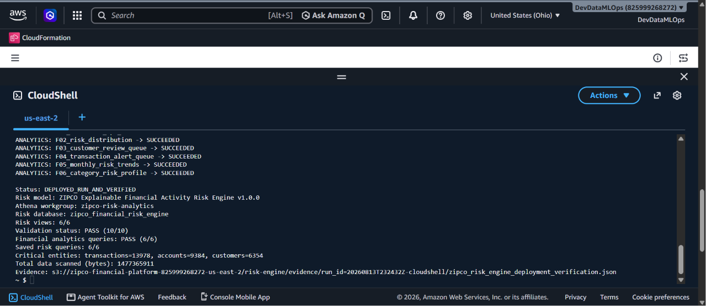
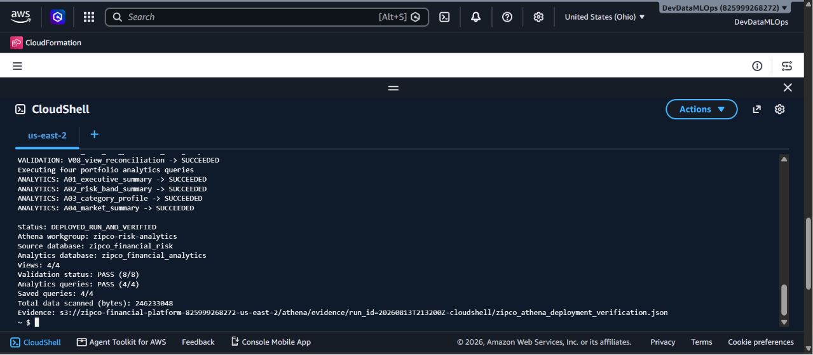
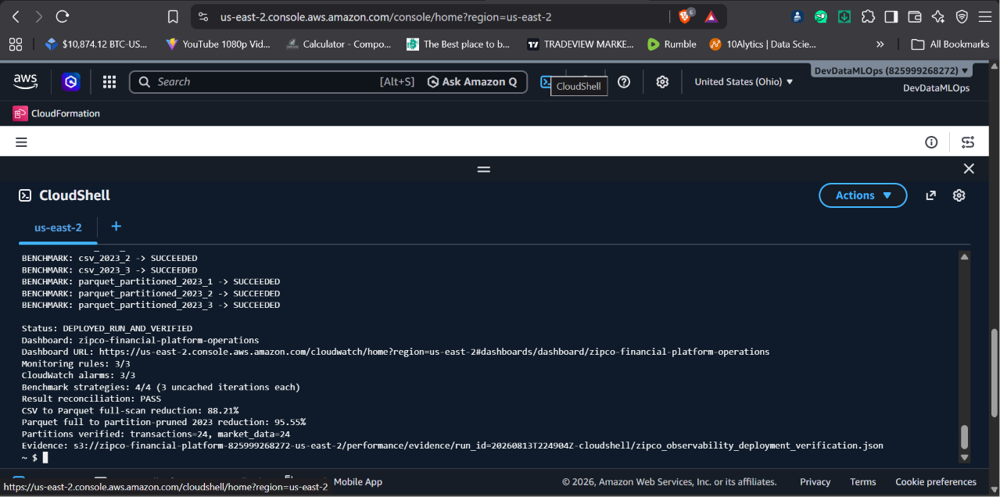

# Portfolio Evidence Catalog

## Primary BI and risk evidence

| Artifact | What it proves |
|---|---|
| [`aws_risk_engine_verification.json`](aws_risk_engine_verification.json) | AWS deployment, model identity, views, validations, analytics, saved queries, critical populations, bytes scanned, run ID, and authoritative S3 evidence URI |
| [`zipco_verified_risk_engine.json`](../contracts/zipco_verified_risk_engine.json) | The deployed semantic layer, scoring bands, explainability policy, verified run, and responsible-use contract |
| [`bi_kpi_snapshot.json`](bi_kpi_snapshot.json) | Machine-readable source financial totals, transaction mix, AWS critical counts, and calibration counts used by the presentation |
| [`calibration_distribution.csv`](calibration_distribution.csv) | Portable exact-percentile pre-deployment risk-band distribution with counts and percentages |
| [`risk_model_contract.json`](../contracts/risk_model_contract.json) | Original pre-deployment scoring components, thresholds, feature policy, calibration, and publication-gate specification |
| [`views/`](../implementation/views/) | Executable Athena feature, score, KPI, and trend semantic views |
| [`analytics/`](../implementation/analytics/) | Six decision-ready BI queries |
| [`validation/`](../implementation/validation/) | Ten publication-gate queries for reconciliation and governance |
| [`deploy_and_run_zipco_risk_engine.sh`](../implementation/deploy_and_run_zipco_risk_engine.sh) | Repeatable deployment, execution, verification, saved-query creation, and S3 evidence capture |
| [`executive-dashboard.md`](../dashboard/executive-dashboard.md) | Portfolio-scale, critical-queue, activity-mix, and calibration presentation |

## Evidence provenance

Financial totals were recomputed from the deterministic relational-v2 files in this workspace. AWS validation `RE-008` passed, proving that the deployed financial KPI view reconciled those customer, account, balance, transaction, and transaction-type totals to the same source layer.

The deployed critical counts and bytes scanned were transcribed from the supplied successful CloudShell output:

```text
Status: DEPLOYED_RUN_AND_VERIFIED
Risk views: 6/6
Validation status: PASS (10/10)
Financial analytics queries: PASS (6/6)
Saved risk queries: 6/6
Critical entities: transactions=13978, accounts=9384, customers=6354
Total data scanned (bytes): 147736591
```

The local calibration distribution is not mislabeled as the deployed AWS distribution. Athena uses `approx_percentile`, so the verified AWS critical populations differ slightly from exact local calibration.

## Screenshots

### 1. Financial analytics and risk engine verified



**Caption:** Six views, ten validations, six analytics queries, and six saved queries passed. The output also records the deployed critical transaction, account, and customer populations and the S3 evidence location.

### 2. Athena semantic layer verified



**Caption:** The governed Athena workgroup and baseline analytics database passed all view, query, and validation checks used as the risk engine's semantic input.

### 3. Parquet and partition foundation verified



**Caption:** The BI workload runs on a verified Parquet and year-partitioned foundation, with measured scan reductions and operational monitoring already deployed.

## Publication note

The screenshots display an AWS account identifier and resource names. The account ID is not a credential, but it may be masked before public publication. No access keys, session tokens, passwords, or customer secrets are shown.

