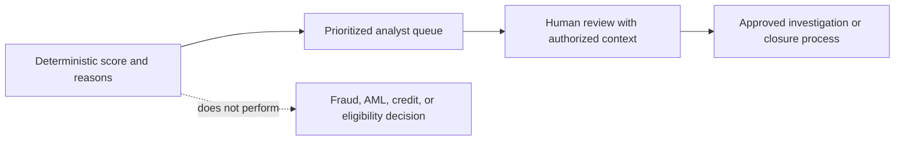

# Governance, Limitations, and Responsible Use

## Approved purpose

This deterministic model demonstrates explainable portfolio monitoring and analyst queue prioritization on synthetic data. It helps organize review work and show why an entity received a score.

## Prohibited representations

The outputs must not be represented as:

- A fraud determination
- An anti-money-laundering disposition
- A credit score or underwriting decision
- An adverse-action mechanism
- A customer eligibility decision
- A production model approved for real customer use

## Human-in-the-loop boundary

## Validation controls

| Rule | Control |
|---|---|
| RE-001 | Scored populations match 1,000,000 transactions, 150,000 accounts, and 100,000 customers |
| RE-002 | Entity keys remain unique and non-null |
| RE-003 | Transaction scores and bands remain in contract |
| RE-004 | Transaction component points reconcile to scores |
| RE-005 | Account components, scores, and bands reconcile |
| RE-006 | Customer components, scores, and bands reconcile |
| RE-007 | Non-zero scores have reasons and all records use v1.0.0 |
| RE-008 | Financial KPIs reconcile to source counts and totals |
| RE-009 | Transaction and account totals reconcile through rollups |
| RE-010 | All four bands are populated at all three levels |

AWS verification reported 10/10 rules passed.

## Important limitations

- The dataset is synthetic and cannot demonstrate real-world predictive validity.
- The model has no labeled fraud, AML, credit-loss, or adverse-outcome target.
- Scores are rule-based priority indicators, not probabilities.
- Thresholds are demonstration choices and require independent validation before any production consideration.
- Athena uses approximate cohort percentiles, so counts can differ slightly from exact local calibration.
- The model has not been evaluated for demographic fairness, disparate impact, drift, stability, precision, recall, or false-positive cost.
- Names, emails, and phones are excluded from scoring, but that alone does not establish fairness.
- Market observations are not joined to transactions because no valid relationship is defined.
- The customer and transaction queues return a maximum of 100 rows and are operational samples, not complete case-management systems.

## Production-readiness requirements

Before a real deployment, a governed organization would need at minimum:

1. A defined outcome and labeled evaluation set.
2. Independent model validation and threshold approval.
3. Fairness, privacy, explainability, and legal review.
4. Role-based access controls and sensitive-data handling.
5. Case-management integration and disposition feedback.
6. Drift, stability, false-positive, and override monitoring.
7. Model inventory, approval, change management, and rollback procedures.
8. Documented accountability for human decisions.

## Portfolio wording

Recommended claim:

> Built an explainable deterministic financial-activity risk engine that prioritizes synthetic transactions, accounts, and customers for analyst review, with component-level reason codes and automated reconciliation controls.

Avoid claims such as “fraud detection model,” “AML model,” or “credit-risk model,” because the evidence does not support those uses.

