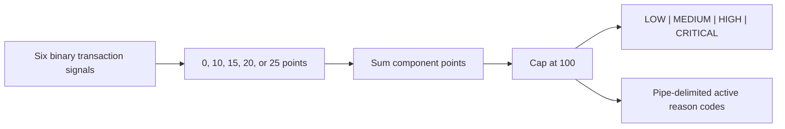
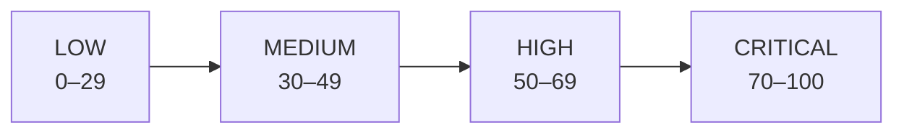

# Risk Model and Explainability Catalog

## Model identity

| Property | Value |
|---|---|
| Name | ZIPCO Explainable Financial Activity Risk Engine |
| Version | 1.0.0 |
| Type | Deterministic rules |
| Score range | 0–100, capped |
| Purpose | Synthetic portfolio monitoring and analyst queue prioritization |
| Entity levels | Transaction, account, customer |

## Transaction components

| Reason code | Points | Condition |
|---|---:|---|
| `BALANCE_EXPOSURE` | 20 | Withdrawal or transfer amount is at least the account balance |
| `HIGH_VALUE` | 15 | Amount is at least 9,000 units |
| `COHORT_P95` | 15 | Amount is at or above the approximate 95th percentile for its type/category cohort |
| `EXTERNAL_TRANSFER` | 25 | Transfer categorized as External Transfer (`CategoryID=410`) |
| `ACCOUNT_AMOUNT_OUTLIER` | 15 | Amount is at least two population standard deviations above the account mean |
| `TRANSFER_ACTIVITY` | 10 | Transaction type is Transfer |

## Account components

| Reason code | Maximum | Calculation or thresholds |
|---|---:|---|
| `MAX_TRANSACTION_RISK` | 50 | 50% of the account's maximum transaction score |
| `RISKY_TRANSACTION_RATE` | 15 | 8 points at 10%; 15 at 25% |
| `OUTGOING_BALANCE_EXPOSURE` | 15 | 5 points at 2×; 10 at 5×; 15 at 10× balance |
| `REPEAT_HIGH_VALUE` | 10 | 5 points at 1; 10 at 3 high-value transactions |
| `REPEAT_EXTERNAL_TRANSFER` | 10 | 5 points at 1; 10 at 3 external transfers |

## Customer components

| Reason code | Maximum | Calculation or thresholds |
|---|---:|---|
| `MAX_ACCOUNT_RISK` | 60 | 60% of maximum account score |
| `MULTIPLE_ELEVATED_ACCOUNTS` | 15 | 8 points at 1; 15 at 2 HIGH/CRITICAL accounts |
| `REPEATED_RISKY_TRANSACTIONS` | 15 | 8 points at 1; 15 at 5 elevated transactions |
| `PORTFOLIO_OUTGOING_EXPOSURE` | 10 | 3 points at 2×; 6 at 5×; 10 at 10× total balance |

## Risk bands

The bands are prioritization tiers. They do not express a calibrated probability of fraud or loss.

## Explainability contract

Every scored view exposes:

- The final score and band.
- Each component's individual points.
- The active reason codes.
- Model version `1.0.0`.
- Operational context appropriate to its entity level.

Validation `RE-007` requires every non-zero score to contain reason codes and every record to contain the expected model version. `RE-004`, `RE-005`, and `RE-006` require component sums and bands to reconcile exactly at all three entity levels.

## Feature policy

Included:

- Transaction amount, type, and category
- Account balance exposure
- Account-relative amount deviation
- Type/category cohort percentile
- Aggregated account activity
- Aggregated customer portfolio activity

Excluded from scoring:

- Customer name
- Email address
- Phone number
- Market data, because the data dictionary defines no transaction relationship

IDs are retained for lineage and review queues but do not contribute points.

