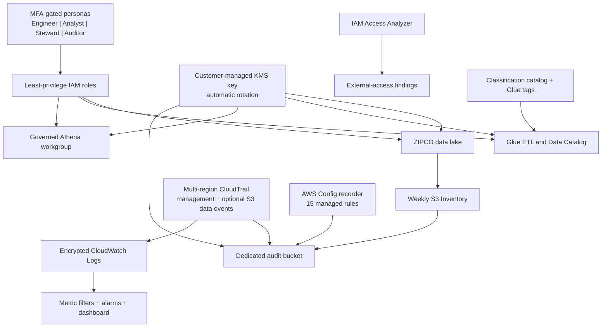

# Phase 5 — Security and Governance

## Status

**DEPLOYED_RUN_AND_VERIFIED — CORE 24/24 AND LAKE FORMATION 18/18 CONTROLS PASSED**

This phase adds the security control plane around the working ZIPCO data platform. The final AWS run verified the customer-managed encryption path, audit plane, four IAM personas, 15 AWS Config rules, Access Analyzer, catalog governance, detection dashboard, and versioned evidence in `us-east-2`.

The isolated [IAM and Lake Formation portfolio demo](lake-formation-demo/README.md) is also deployed and verified. Its 18/18 controls prove LF-tag-based access, 12/12 scoped hybrid opt-ins, and observed allow/deny Athena probes without changing the permission model of the verified analytics databases.

## What is implemented

| Control plane | Implementation |
|---|---|
| Encryption | Customer-managed symmetric KMS key, 30-day deletion window, annual automatic rotation, S3 Bucket Keys |
| Storage | Dedicated private/versioned audit bucket, TLS-only policy, lifecycle retention, primary-bucket SSE-KMS upgrade for new writes |
| Audit | Multi-region CloudTrail, log-file validation, encrypted S3 and CloudWatch delivery, optional S3 object data events |
| Identity | MFA-gated data engineer, risk analyst, data steward, and security auditor roles |
| Least privilege | S3 prefix, Glue resource, Athena workgroup, catalog, audit, and KMS permissions separated by persona |
| External access | Account-level IAM Access Analyzer or verified reuse of an existing account analyzer |
| Compliance | Active AWS Config recorder plus 15 managed rules for S3, CloudTrail, KMS, and identity posture |
| Detection | Root-use, denied-API, and KMS disable/delete metric filters, alarms, and a security dashboard |
| Inventory | Weekly S3 Inventory with encryption-status metadata delivered to the audit bucket |
| Data governance | Column-level classification catalog plus verified ownership/classification/version tags on Glue databases; table coverage is reconciled to the catalog because Glue tables do not support Glue resource tags |
| Responsible use | Human-review boundary and explicit prohibitions on automated fraud, AML, credit, eligibility, or adverse decisions |
| Lake Formation demo | Isolated registered prefix, LF-TBAC grants for four personas, authorized query probe, expected-denial probe, and regression guard |

## Architecture



## Portfolio proof

The phase is designed to demonstrate more than a list of AWS security services. Its proof chain is:

1. Infrastructure-as-code creates named, inspectable controls.
2. Automation upgrades the existing data path without deleting or rewriting source data.
3. Verification reads the deployed AWS state back through service APIs.
4. Mandatory controls fail closed if their observed state differs from the contract.
5. A versioned JSON evidence record is uploaded to S3.
6. AWS Config findings are reported separately from infrastructure deployment status, so account-level posture is not misrepresented.

See [security architecture](security-architecture.md), [control matrix](control-matrix.md), [identity model](iam-and-access-model.md), [governance policy](data-governance-policy.md), and the [deployment runbook](implementation/DEPLOYMENT_RUNBOOK.md).

## Evidence boundary

The supplied CloudShell completion output is retained under [`screenshots`](screenshots), and a transparent local transcription is retained under [`evidence`](evidence/aws_security_governance_verification.json). The authoritative machine-generated evidence remains at the run-specific S3 URI recorded in that file.

For additional visual proof, retain:

- `zipco_security_governance_deployment_verification.json`
- KMS, CloudTrail, Config, Access Analyzer, and security-dashboard screenshots

The evidence catalog defines the required capture set.

## Cost boundary

AWS KMS keys, AWS Config recording and evaluations, CloudTrail data events, CloudWatch Logs, and stored audit data can incur charges. S3 object data events default to enabled for stronger proof but can be disabled before running with:

```bash
ENABLE_S3_DATA_EVENTS=false ./deploy_and_verify_zipco_security_governance.sh
```

Disabling them intentionally leaves the related AWS Config rule noncompliant and is reported as a cost-driven exception rather than hidden.
