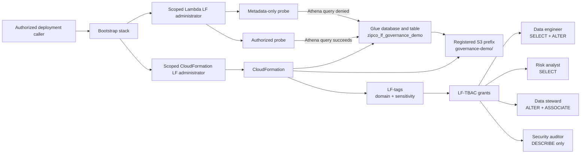

# IAM and Lake Formation Portfolio Demo

## Status

**DEPLOYED_RUN_AND_VERIFIED — 18/18 LAKE FORMATION CONTROLS PASSED**

This extension turns the Phase 5 IAM design into an observable Lake Formation access-control demonstration. It creates one isolated catalog and S3 prefix, applies LF-tags, maps four human personas to different permissions, and executes both a successful and an intentionally denied Athena query.

It does **not** change Lake Formation authorization on the existing `zipco_financial_risk`, `zipco_financial_analytics`, or `zipco_financial_risk_engine` databases.

## What the demo proves

| Proof | Implementation |
|---|---|
| Identity separation | Existing engineer, analyst, steward, and auditor roles receive distinct IAM and Lake Formation capabilities |
| Storage enforcement | `governance-demo/` is registered with Lake Formation in hybrid access mode using a dedicated data-access role |
| Classification | `zipco-domain=risk-analytics` and `zipco-sensitivity=internal` LF-tags are attached to catalog resources |
| Tag-based authorization | Persona access is granted through LF-tag policy expressions rather than S3 object grants |
| Positive test | An automation-only reader role executes `SELECT count(*)` successfully through Athena |
| Negative test | A metadata-only role has the same query-path IAM permissions but no Lake Formation `SELECT`; its query must fail |
| Regression boundary | Before/after table counts verify that the three existing analytics databases were not changed |
| Audit evidence | A versioned JSON record captures registration, tags, grants, opt-ins, query IDs, outcomes, and integrity hashes |

## Architecture



## Safe isolation model

- The only registered location is `s3://<zipco-bucket>/governance-demo/`.
- Hybrid opt-ins apply only to `zipco_lf_governance_demo` and `risk_band_summary`.
- Existing analytics databases are read only for before/after table-count comparison.
- The four-row CSV is a deterministic access-control fixture, not a customer dataset or business result.
- The two probe roles are automation-only, are trusted solely by the scoped validation role, and exist to validate allow/deny behavior.

## Deployment

Use the [CloudShell runbook](implementation/DEPLOYMENT_RUNBOOK.md). The script must finish with:

```text
Status: DEPLOYED_RUN_AND_VERIFIED
Lake Formation controls: PASS (18/18)
Authorized query: SUCCEEDED
Metadata-only query: FAILED_AS_EXPECTED
Existing analytics catalog: UNCHANGED (3/3 databases)
```

The verified AWS run produced that output. The final CloudShell screenshot is retained in [`screenshots/01-lake-formation-demo-verified.png`](screenshots/01-lake-formation-demo-verified.png), and its source-labeled transcription records the authoritative S3 evidence URI.

Verified portfolio claim:

> Deployed and verified Lake Formation tag-based access control with an observed authorized query, an observed denied query, and no changes to the existing analytics databases.

See the [access-control matrix](access-control-matrix.md), [portfolio presentation](portfolio-presentation.md), [evidence catalog](evidence/evidence-catalog.md), and [portfolio checklist](portfolio-proof-checklist.md).
