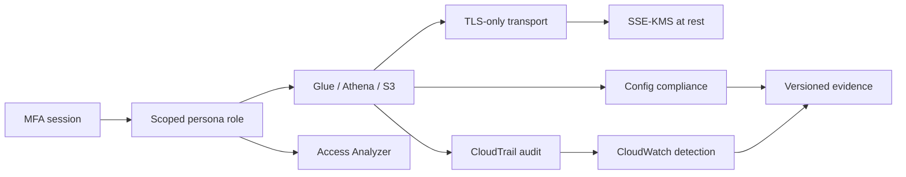

# Security Architecture and Trust Boundaries

## Security objective

Protect the confidentiality, integrity, availability, and auditability of ZIPCO's synthetic financial data while preserving the working S3 → Glue → Catalog → Athena → risk-analytics flow.

## Trust boundaries

| Boundary | Protected assets | Control |
|---|---|---|
| Human to AWS | Console and API sessions | MFA-gated role assumption; root-use alarm; temporary sessions |
| Identity to storage | Raw, validated, curated, quality, metadata, and result objects | Prefix-scoped IAM, TLS-only bucket policies, public-access blocks |
| Service to encryption | S3, Glue, Athena, catalog, CloudTrail, CloudWatch | One customer-managed symmetric KMS key with service-specific policy statements |
| Pipeline to analytics | Catalog tables and Athena views | Glue resource scope, governed workgroup, 500 MiB scan cutoff, enforced result settings |
| Platform to audit plane | CloudTrail, Config, inventory, compliance evidence | Separate retained audit bucket and encrypted CloudWatch log group |
| Analytics to decisions | Risk scores and queues | Human review; no automated fraud/AML/credit/eligibility decision authority |

## Defense in depth

No single control is treated as sufficient. IAM limits who can request access; bucket and workgroup controls constrain how services operate; KMS protects new encrypted material; CloudTrail records activity; Config evaluates posture; and verification proves the observed state.

## Encryption transition

The deployment changes the primary bucket's default encryption from SSE-S3 to SSE-KMS with an S3 Bucket Key. AWS applies that default to new writes. Existing object versions retain their original encryption until a separately approved copy or S3 Batch Operations migration is performed. This prevents a portfolio exercise from silently rewriting the immutable raw zone.

Glue is updated to use SSE-KMS for S3 outputs and CloudWatch Logs and CSE-KMS for bookmarks. Athena result configuration is updated from `SSE_S3` to enforced `SSE_KMS`. New Glue Data Catalog metadata is encrypted with the same key through a dedicated catalog-encryption service role.

## Audit design

- CloudTrail is multi-region and includes global service events.
- Log-file integrity validation is enabled.
- Management events are always recorded.
- Primary-bucket object events are controlled by the `ENABLE_S3_DATA_EVENTS` cost switch.
- CloudTrail delivers to both a retained audit bucket and a 90-day encrypted CloudWatch Logs group.
- S3 Inventory independently records object encryption status each week.

AWS recommends CloudTrail for bucket- and object-level API auditing; object data events incur charges. See the AWS documentation for [S3 logging options](https://docs.aws.amazon.com/AmazonS3/latest/userguide/logging-with-S3.html) and [CloudTrail data events](https://docs.aws.amazon.com/AmazonS3/latest/userguide/enable-cloudtrail-logging-for-s3.html).

## Deliberate boundaries

- Lake Formation enforcement is not activated on the three verified analytics databases because revoking `IAMAllowedPrincipals` could interrupt working Glue and Athena workloads. The isolated [`zipco_lf_governance_demo`](lake-formation-demo/README.md) uses hybrid opt-ins and LF-TBAC to prove fine-grained authorization safely; migration of the live catalogs remains a separate controlled production change.
- Macie is not enabled for the synthetic dataset. Real sensitive data requires a privacy assessment and a funded Macie or equivalent discovery control.
- Alarms have no external action until an approved destination is supplied.
- Existing S3 objects are inventoried, not automatically rewritten.
