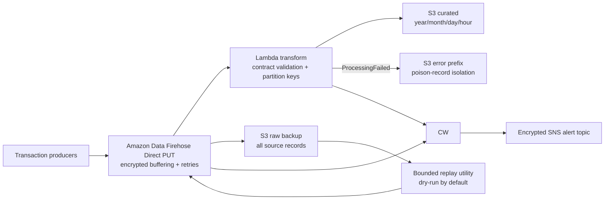

# Phase 6 — CloudWatch, Streaming, and Resilience

## Status

**SELECTED FREE-PLAN VARIANT: `DEPLOYED_RUN_AND_VERIFIED` — `PASS (20/20)`**

**OPTIONAL FIREHOSE VARIANT: UNDEPLOYED REFERENCE — ACCOUNT PLAN REJECTED SERVICE ACCESS**

This phase now contains two explicitly separated deployment variants:

- [`free-plan-implementation`](free-plan-implementation/README.md) — deployable near-real-time Lambda event processing with encrypted S3 recovery and CloudWatch controls. This is the selected account-compatible variant and does **not** claim native streaming.
- [`implementation`](implementation/README.md) — optional Firehose Direct PUT architecture and automation. AWS rejected this service with `OptInRequired` on the Free-plan account, so it remains undeployed reference material.

Both variants validate schema-v2.1.0 events, preserve a raw recovery copy, isolate invalid records, provide bounded replay, and expose operational health through CloudWatch. Only the Free-plan variant should be executed on the current account.

## Verified operational outcome

| Result | Verified outcome |
|---|---:|
| Deployment | `DEPLOYED_RUN_AND_VERIFIED` |
| Selected variant | `FREE_PLAN_LAMBDA_EVENT_PROCESSING` |
| Native streaming service | `NOT CLAIMED` |
| Mandatory event-resilience controls | `PASS (20/20)` |
| Valid records curated | 25/25 |
| Expected-invalid records quarantined | 3/3 |
| Recovery exercise | Encrypted raw backup enabled; replay dry run passed |
| CloudWatch | 4 metric alarms; 1 composite alarm |
| Processor | `zipco-free-plan-event-processor-dev` |
| AWS run ID | `20260821T215343Z-cloudshell` |

See the [operational demo](operational-demo.md) for the deployed flow, failure injection, recovery walkthrough, evidence mapping, claim boundary, and resume-ready outcomes.

The [GitHub operational dashboard](dashboard/README.md) turns the verified run into a concise portfolio view with explicit evidence links and the same non-streaming claim boundary.

## Optional managed-streaming reference

| Capability | Implementation |
|---|---|
| Streaming ingress | Encrypted Amazon Data Firehose delivery stream using Direct PUT |
| Managed delivery | Firehose buffers, transforms, retries, and delivers records to S3 |
| Validation | Lambda enforces required keys, types, amount bounds, timestamp timezone, transaction domain, and schema version |
| Curated layout | GZIP NDJSON partitioned by event year, month, day, and hour |
| Poison-record handling | Invalid records return `ProcessingFailed` and are isolated under a typed Firehose S3 error prefix |
| Durable recovery | All source records are copied to an immutable S3 raw backup before any replay decision |
| Replay | Bounded utility defaults to dry-run and requires an explicit `--execute` flag |
| Monitoring | Dashboard for Firehose ingress/delivery, Lambda, delivery freshness, backup volume, and alarm state |
| Alerting | Four metric alarms, one composite health alarm, and SNS routing encrypted by a dedicated rotating customer-managed key |
| Evidence | Automated 20-control verifier and run-specific S3 evidence publication |

The table and architecture below document the optional managed-streaming design. See the [Free-plan implementation](free-plan-implementation/README.md) for the selected deployable architecture and its distinct `FP-001` through `FP-020` controls.

## Optional Firehose architecture

## Optional Firehose resilience claim

The phase provides **at-least-once delivery**. It does not claim exactly-once processing. A replay can create duplicates, so `transaction_id` is explicitly documented as the downstream idempotency key. No ordering guarantee is claimed across Direct PUT requests.

The failure path is deliberate:

1. Firehose retries transient transformation and S3 delivery problems.
2. Every input event is copied to `streaming/raw/` when S3 backup is enabled.
3. Business-invalid or malformed events are written beneath `streaming/errors/`.
4. Operators inspect the raw source, select a bounded set, run the replay utility in dry-run mode, then explicitly authorize `--execute`.

See [architecture and resilience design](architecture-and-resilience.md) and the [operations runbook](operations-runbook.md).

## Optional Firehose verification design

The deployment publishes 25 deterministic valid records and three expected-invalid records. It passes only when:

- Firehose and Lambda report healthy deployed states.
- Direct PUT, transport encryption, dynamic partitioning, bounded buffering, and raw backup match the contract.
- All 25 valid records are observed under curated S3.
- At least one error object is observed after poison-record injection.
- Raw, curated, and error objects are observed with SSE-KMS.
- Four metric alarms, one composite alarm, the dashboard, logging, and the alert topic are present.
- The publisher reports zero failed Firehose writes.

The 20 mandatory gates are in the [streaming resilience contract](contracts/streaming_resilience_contract.json).

## Portfolio proof

- [Architecture and resilience design](architecture-and-resilience.md)
- [Operations runbook](operations-runbook.md)
- [Streaming resilience contract](contracts/streaming_resilience_contract.json)
- [Deployable infrastructure and automation](implementation/README.md)
- [Free-plan deployable event-processing fallback](free-plan-implementation/README.md)
- [Verified operational demo](operational-demo.md)
- [GitHub operational dashboard](dashboard/README.md)
- [AWS verification transcription](evidence/aws_free_plan_event_resilience_verification_transcript.json)
- [Successful CloudShell screenshot](screenshots/01-free-plan-event-resilience-verified.png)
- [Evidence catalog](evidence/evidence-catalog.md)
- [Screenshot capture guide](screenshots/README.md)
- [Completion checklist](portfolio-proof-checklist.md)

## Cost boundary

The selected deployment uses Lambda, S3, CloudWatch alarms/metrics/logs, SNS, and customer-managed KMS keys; these consume Free-plan credits and must still be reviewed for retention. The optional Firehose design would add Firehose ingestion charges if deployed under a paid plan. Delete unneeded demo stacks only after preserving evidence, and review retained keys, log groups, and S3 objects separately.
