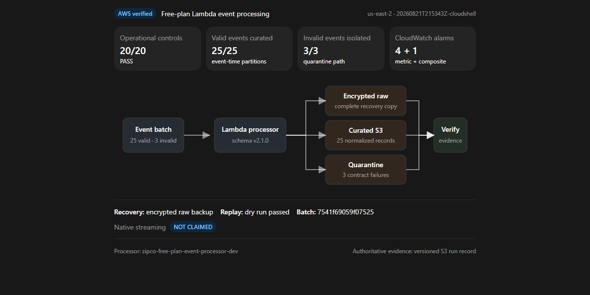
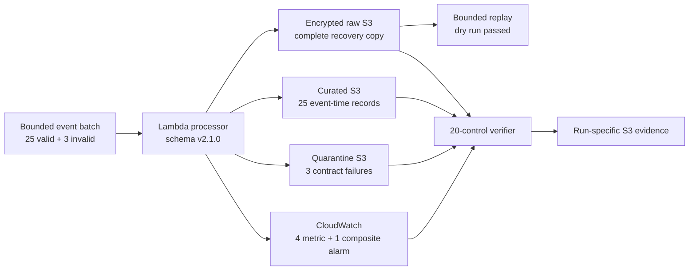

# Operational Resilience Dashboard

**AWS status: `DEPLOYED_RUN_AND_VERIFIED` · Free-plan Lambda event processing · Native streaming `NOT CLAIMED`**

| Operational controls | Valid events curated | Invalid events quarantined | CloudWatch alarms |
|---:|---:|---:|---:|
| **20/20 PASS** | **25/25** | **3/3** | **4 metric + 1 composite** |

## Recovery posture

| Control | Verified result |
|---|---|
| Raw-first recovery | Complete invocation batch persisted with encryption |
| Contract isolation | Missing account, negative amount, and unsupported schema events quarantined |
| Replay safety | Dry-run default, 500-record bound, deterministic batch ID `7541f69059f07525` |
| Delivery semantics | At least once; downstream de-duplication uses `transaction_id` |
| Processor | `zipco-free-plan-event-processor-dev` |
| Run ID | `20260821T215343Z-cloudshell` |

## Evidence links

- [Standalone visual dashboard](index.html)
- [Operational demonstration and interview walkthrough](../operational-demo.md)
- [Source-labelled AWS verification transcription](../evidence/aws_free_plan_event_resilience_verification_transcript.json)
- [Successful CloudShell screenshot](../screenshots/01-free-plan-event-resilience-verified.png)
- [Evidence catalog](../evidence/evidence-catalog.md)
- [CloudWatch dashboard in AWS](https://us-east-2.console.aws.amazon.com/cloudwatch/home?region=us-east-2#dashboards/dashboard/zipco-financial-platform-free-plan-events-dev)

The authoritative machine-generated evidence remains at the run-specific S3 URI recorded in the verification transcription. The checked-in dashboard presents those verified results; it is not a live CloudWatch data source.
