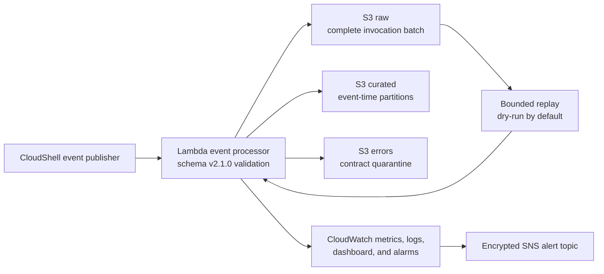

# Free-plan Event Processing and Resilience

## Status

**DEPLOYED_RUN_AND_VERIFIED — 20/20 CONTROLS PASSED**

This is the deployable Phase 6 variant for an AWS Free-plan account that rejects Kinesis and Firehose with `OptInRequired`. It uses synchronous, bounded Lambda event batches; encrypted S3 raw, curated, and error paths; safe replay; and CloudWatch operational controls.

It is intentionally described as **near-real-time event processing**, not native managed streaming. The optional Firehose design remains in the parent [`implementation`](../implementation/README.md) directory as architecture and paid-plan deployment material.

## Architecture

## Files

| File | Purpose |
|---|---|
| `zipco_free_plan_event_resilience_infrastructure.json` | Lambda, least-privilege IAM, encrypted logs/alerts, four metric alarms, composite alarm, and dashboard |
| `event_contract.py` | Schema-v2.1.0 validation and normalization |
| `lambda_event_processor.py` | Raw-first S3 persistence, validation, curated partitions, quarantine, and custom metrics |
| `publish_free_plan_events.py` | Deterministic valid and poison-record verification batch |
| `replay_free_plan_events.py` | Bounded dry-run-by-default recovery utility |
| `verify_free_plan_event_resilience.py` | Automated AWS delivery and 20-control verification |
| `deploy_and_verify_zipco_free_plan_event_resilience.sh` | CloudShell deployment, test, proof, and evidence workflow |
| `free_plan_event_resilience_contract.json` | Truthful claim boundary and mandatory controls |
| `aws_free_plan_event_resilience_verification.template.json` | Explicit pending-evidence placeholder with the non-streaming claim boundary |

## Completion evidence

AWS run `20260821T215343Z-cloudshell` finished with `DEPLOYED_RUN_AND_VERIFIED` and `PASS (20/20)`. It curated 25/25 valid records, quarantined 3/3 expected-invalid records, verified the encrypted raw recovery path, passed the bounded replay dry run, and verified four metric alarms plus one composite alarm.

The evidence explicitly records `native_streaming_service: false`, preventing the fallback from being misrepresented as a Firehose or Kinesis deployment. See the [operational demo](../operational-demo.md), [source screenshot](../screenshots/01-free-plan-event-resilience-verified.png), and [source-labelled transcript](../evidence/aws_free_plan_event_resilience_verification_transcript.json).
