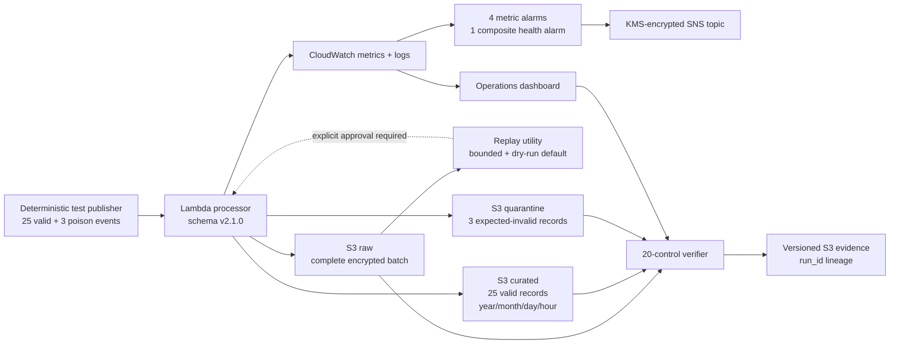

# Operational Event-Resilience Demo

## Demonstrated outcome

The selected AWS Free-plan implementation is **deployed, exercised, and verified** in `us-east-2`. It processes bounded transaction-event batches through Lambda, writes a complete encrypted raw recovery copy, publishes valid records into event-time S3 partitions, quarantines contract-invalid records, exercises replay in dry-run mode, and exposes health through CloudWatch.

This is deliberately presented as **near-real-time serverless event processing**, not as Kinesis or Firehose streaming. The current account plan rejected those native services, and the repository preserves their design separately without claiming deployment.

| Operational result | Verified outcome |
|---|---:|
| Deployment | `DEPLOYED_RUN_AND_VERIFIED` |
| Variant | `FREE_PLAN_LAMBDA_EVENT_PROCESSING` |
| Mandatory controls | `PASS (20/20)` |
| Valid records curated | 25/25 |
| Expected-invalid records quarantined | 3/3 |
| Recovery source | Encrypted S3 raw backup enabled |
| Recovery exercise | Bounded replay dry run passed |
| CloudWatch metric alarms | 4 |
| CloudWatch composite alarms | 1 |
| Processor | `zipco-free-plan-event-processor-dev` |
| AWS run ID | `20260821T215343Z-cloudshell` |

## Deployed operating flow

## Failure and recovery demonstration

The deployment injects three controlled contract failures:

1. A record missing `account_id`.
2. A record with a negative amount.
3. A record with an unsupported schema version.

The processor first persists the complete invocation batch to the encrypted raw path. It then accepts 25 conforming records and sends the three expected failures to the error path. This separates data-quality rejection from invocation-level failure, preserves forensic lineage, and prevents invalid events from contaminating curated output.

The recovery utility scans the immutable raw path, filters on the run ID, caps selection at 500 records, computes a deterministic replay fingerprint, and defaults to inspection-only mode. The verified demo selected the complete batch with replay fingerprint `7541f69059f07525`; no replay mutation occurred because `--execute` was not authorized.

## CloudWatch operating model

The deployed dashboard presents:

- accepted, rejected, and batch-failure event metrics;
- Lambda invocations, errors, throttles, and duration;
- the four metric alarms and composite health state;
- sanitized processor batch summaries without transaction payloads.

The alarm set covers processor errors, throttles, duration exceeding the one-minute operational target, and explicit batch failures. Alarm and recovery transitions route through an SNS topic protected by a rotating customer-managed KMS key.

## Five-minute portfolio walkthrough

1. Open the CloudFormation stack `zipco-free-plan-event-resilience` and show `CREATE_COMPLETE` or `UPDATE_COMPLETE`.
2. Open Lambda function `zipco-free-plan-event-processor-dev` and show Python 3.12, the schema-version environment variable, and the scoped execution role.
3. Open S3 prefix `streaming-free-plan/` and show `raw/`, `curated/`, `errors/`, and `evidence/`.
4. Open the CloudWatch dashboard `zipco-financial-platform-free-plan-events-dev` and explain the outcome and health widgets.
5. Show the final CloudShell output with `PASS (20/20)`, 25/25 curated, 3/3 quarantined, and replay dry-run success.
6. Finish with the authoritative S3 evidence URI and explain that the checked-in JSON is a screenshot transcription, not a substituted machine export.

## Evidence and provenance

- [GitHub operational dashboard](dashboard/README.md)
- [Successful CloudShell verification screenshot](screenshots/01-free-plan-event-resilience-verified.png)
- [Source-labelled verification transcription](evidence/aws_free_plan_event_resilience_verification_transcript.json)
- [Free-plan implementation and 20-control contract](free-plan-implementation/README.md)
- Authoritative AWS evidence: `s3://zipco-financial-platform-825999268272-us-east-2/streaming-free-plan/evidence/run_id=20260821T215343Z-cloudshell/zipco_free_plan_event_resilience_verification.json`

## Claim boundary

- Demonstrated: Lambda event processing, schema enforcement, raw-first recovery, curated partitions, contract quarantine, bounded replay, CloudWatch monitoring, least-privilege IAM, KMS encryption, and machine-generated evidence publication.
- Not claimed: Kinesis or Firehose deployment, shard ordering, sub-second latency, exactly-once delivery, automated production replay, a measured disaster-recovery RTO, or a production-scale load test.

## Resume-ready outcomes

- Built and AWS-verified a serverless financial event-processing path with encrypted raw recovery, schema-v2.1.0 validation, partitioned curated output, and poison-record quarantine; all 20 operational controls passed.
- Implemented a safe replay workflow with a deterministic batch fingerprint, 500-record bound, dry-run default, and explicit execution gate.
- Delivered a CloudWatch operations dashboard, four metric alarms, a composite health alarm, encrypted alert routing, and run-specific S3 evidence while preserving a truthful non-streaming claim boundary.
